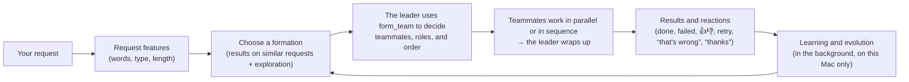

<p align="center">
  
</p>

<h1 align="center">Jellyfish AI</h1>

<p align="center">
  <a href="https://github.com/Rhizobium-gits/jellyfish-ai/actions/workflows/ci.yml"></a>
  <a href="https://github.com/Rhizobium-gits/jellyfish-ai/releases/latest"></a>
  <a href="https://github.com/Rhizobium-gits/jellyfish-ai/releases"></a>
  <a href="LICENSE"></a>
  
</p>

<p align="center">
  <a href="README.md">日本語</a> · <b>English</b> · <a href="README.zh-CN.md">简体中文</a>
</p>

<p align="center">
  A macOS app where AI agents live on your desktop, each one running as an independent AI agent（Claude Code・Codex・Gemini）.<br>
  Press ⌘L, type, and watch it think, work and finish.
</p>

<p align="center">
  <a href="https://github.com/Rhizobium-gits/jellyfish-ai/releases/latest/download/JellyfishAI.dmg"><b>⬇︎ Download (.dmg)</b></a>
  &nbsp;·&nbsp; <a href="#key-features">Key features</a>
  &nbsp;·&nbsp; <a href="#download-and-install">Install</a>
  &nbsp;·&nbsp; <a href="#getting-started">Getting started</a>
  &nbsp;·&nbsp; <a href="#ai-engines-and-accounts">AI engines</a>
  &nbsp;·&nbsp; <a href="#team-division-of-labor">Team</a>
  &nbsp;·&nbsp; <a href="#grant-or-revoke-macos-permissions-all-at-once">🔐 Permissions</a>
  &nbsp;·&nbsp; <a href="#updates">Updates</a>
</p>

<p align="center">
  
</p>

> [!NOTE]
> This is an unofficial app made by an individual. It is not affiliated with Anthropic, OpenAI or Google. Claude, Claude Code and the Claude Code character belong to Anthropic; ChatGPT and Codex belong to OpenAI; Gemini belongs to Google.

## Key features

| | |
|---|---|
| **⌘L for an instant agent** | From any app, ⌘L brings out a new jellyfish and you can type your instruction right away. The jellyfish shows “thinking, working, done, error” through its movement, and tapping it opens the result and a chat to continue |
| **Choose your AI** | Claude (Claude Code), ChatGPT (Codex CLI) and Gemini (Gemini CLI). Choose the AI, model and thinking effort per jellyfish. You sign in on each one's official screen, and an AI that isn't installed can be installed, all the way through sign-in, once you allow it |
| **Divide work as a team** | Bring jellyfish close to each other to link them, and they split the work by asking teammates or bringing out new ones. **Across AIs**, a Claude jellyfish can bring out ChatGPT teammates and a ChatGPT jellyfish can bring out Claude teammates. Requests and results travel back and forth along the lines as light |
| **Autonomous organization mode** | For each request, the agent decides on the team's shape and assembles it on its own, then learns from the results and 👍👎 to evolve how it chooses an organization |
| **Chat** | Like the ChatGPT, Claude and Gemini apps, **tables, math, diagrams and charts, and highlighted code** are shown as they are. Images and PDFs appear as thumbnails, web pages with their cover and title. 🎙 Mac Dictation, 🎧 system audio transcription, screen and file attachments, ↑↓ for previous instructions |
| **PC control** | Only jellyfish you allow can look at the screen, click and type (Claude). The edges of the screen glow while it's in control, and Esc stops it |
| **👀 Watching** | A jellyfish reads the front window **on this Mac only** (0 tokens, nothing sent) and asks “take a look?” when something looks like an error. Only that one image is sent, and only if you press it (per jellyfish, off by default) |
| **🔐 Permissions** | Lists the macOS permissions (Accessibility, Screen Recording, Full Disk Access, Automation) and what each one enables, and grants or revokes them all at once |
| **See your usage** | Bars in the menu bar for Claude's weekly limit and ChatGPT's 5-hour and weekly limits. Plus calls and tokens per AI, per model and per account |
| **No surprise charges** | Doesn't handle API keys, and doesn't use AIs signed in on pay-as-you-go (Claude included) |
| **Updates** | From the app, from Terminal, or with a single command. Checks the checksum, contents and signature before replacing the app |
| **日本語, English, 简体中文** | Menus and the guidance given to agents are in the language you choose |

<p align="center">
  
</p>

## Download and install

**Requirements**

- macOS 14 or later. It's a universal build that runs on both Apple silicon and Intel (tested on macOS 26 on Apple silicon). Transcribing system audio requires macOS 26 or later
- At least one of these AI CLIs ([AI engines and accounts](#ai-engines-and-accounts)). Claude Code supports the most features. Even if none is installed, you can install one from the app once you allow it
  - [Claude Code](https://code.claude.com/docs/en/setup) (Claude account). Jellyfish AI automatically picks the newest `claude` from your PATH, `~/.local/bin`, Homebrew, and the copy bundled with the VS Code / Cursor extension
  - [Codex CLI](https://github.com/openai/codex) (ChatGPT account). The Codex CLI bundled with the ChatGPT desktop app is found automatically too, and works as is if you're signed in to ChatGPT in the app
  - [Gemini CLI](https://github.com/google-gemini/gemini-cli) (Google account)

1. **Download**
   **[Download JellyfishAI.dmg](https://github.com/Rhizobium-gits/jellyfish-ai/releases/latest/download/JellyfishAI.dmg)** (always the latest version; the same file is on [the latest release](https://github.com/Rhizobium-gits/jellyfish-ai/releases/latest) page. There's also a `.zip` with the same contents)
2. **Move it to the Applications folder**
   Open the .dmg and drag **JellyfishAI** onto the **Applications** folder next to it
3. **Click “Open Anyway” the first time only**
   The first time you open JellyfishAI from the Applications folder, macOS stops it, saying it can't be opened (because it's a personal project that hasn't been notarized by Apple). Close the dialog and click “Open Anyway” near the bottom of **System Settings › Privacy & Security**. From the second time on, it opens normally
4. **Sign in to an AI**
   The first time you open it, the “Accounts & AI” screen appears. Press “Sign in…” for the AI you want to use, and its official sign-in starts in Terminal, so all you have to do is sign in in your browser. For an AI that isn't installed, “Install & sign in…” shows you the command it will run and asks for permission before installing it

To check that the download isn't corrupted, compare the output of `shasum -a 256 JellyfishAI.dmg` with `SHA256SUMS.txt` from the same release.

> [!IMPORTANT]
> Agents create, edit and delete files and run commands **without asking** (Claude Code's Auto mode, Codex's sandbox, Gemini's auto_edit; each AI's own safety features stop dangerous operations). The working folder is your home folder by default. For details, see [Permissions and safety](#permissions-and-safety) and [SECURITY.md](SECURITY.md).
>
> Agents run on your AI accounts (Claude Pro / Max, ChatGPT, Google) and consume their usage. **Jellyfish doesn't handle API keys and never charges you on its own**. Claude Code alone uses tens of thousands of tokens per call for its baseline, so running many jellyfish in parallel reaches your usage limits quickly. You can check how much you've used from the menu bar jellyfish.

## How to launch

You don't need Terminal. Open it like any other Mac app.

| Where | How |
|---|---|
| **Spotlight** | Press ⌘Space, type “Jellyfish”, and press Enter |
| **Launchpad / Apps** | Click the Jellyfish AI icon |
| **Finder** | Double-click JellyfishAI in the “Applications” folder |
| **Dock** | Drag JellyfishAI from the Applications folder to the Dock, and from then on it's a single click |
| **Automatically at login** | Turn on menu bar jellyfish › **Open at login** |

- Once launched, a pixel-art jellyfish icon appears in the menu bar. Jellyfish AI is a resident app, so it normally doesn't appear in the Dock (it shows up in the Dock and ⌘Tab only while a chat window is open)
- Opening the app icon again while it's running brings back any hidden jellyfish. If there are none, it brings out a new jellyfish
- To quit, choose menu bar jellyfish › **Quit Jellyfish AI** (⌘Q). Running agents are interrupted

## Getting started

1. Press **⌘L** from any app, and a new jellyfish appears with an input field open
2. Write what you want done and press **Enter**. The input field closes, and the jellyfish works while showing its state through its movement
3. **Tap** a jellyfish that has finished to read the result in the chat window. You can keep giving instructions right there
4. **Long-press** a jellyfish you no longer need to remove it

If you use PC control or screen attachments, “Grant All” in the menu bar jellyfish › **🔐 Permissions (Full Access)** sets up the macOS permissions all at once ([Grant or revoke macOS permissions all at once](#grant-or-revoke-macos-permissions-all-at-once)).

<p align="center">
  
</p>

## Menu bar

Click the jellyfish in the menu bar, and **your accounts and usage** appear at the very top.

- **Claude**: the email and plan of the signed-in account (e.g. Claude Max 20x), and bars for this week's usage (**all models** and **Fable**, each with its reset date and time; orange at 75%, red at 90%). When you open the menu, if at least a minute has passed since the last read, it re-reads them with `claude auth status` and `claude -p /usage` (`/usage` is a built-in command, so no model is called and no tokens are used)
- **ChatGPT (Codex)**: if you're signed in, the plan (e.g. ChatGPT Plus) and bars for the **5-hour and weekly limits**. It only reads the values Codex CLI wrote in its own records the last time it was used
- **Gemini**: if you're signed in, the number of runs from Jellyfish (today, 7 days)
- **📊 Usage (per AI, last 7 days)**: calls and tokens per AI, per model and per account (what Jellyfish ran, using the numbers the CLIs report; counted on this Mac only)

Below that are New jellyfish, Hide / Show all, past sessions and the list of agents, followed by these settings.

| Item | Description |
|---|---|
| Appearance, Size | Pixel-art / realistic jellyfish, and size |
| Screen awareness | Which display is captured when you say “this screen” (the display with the app you were using / all displays) |
| 🔑 Accounts & AI | Sign-in status, AI to use (default), sign in, install & sign in, and allowing use with API keys |
| 🧠 Model (default) | The default model for each AI |
| Execution policy | The rules for running each AI without asking, and the location and version of the CLIs in use |
| PC control | The agents you've allowed, and stopping them right now |
| 🔐 Permissions (Full Access) | Grant or revoke macOS permissions all at once |
| Team (division of labor), 🧬 Autonomous organization | Turn division of labor and autonomous organization on or off; the learning report and reset |
| External tools (MCP) | Only when named / Always / Don't use |
| Show web page previews in chats | Cover images and titles of web pages (images and PDFs are shown even when it's off) |
| Open at login, 🌐 Language | |
| About Jellyfish AI, Check for updates… | |

## Chat

The chat window that opens when you tap a jellyfish is a normal Mac window (minimize, full screen, resize freely).

- **Top row**: AI (Claude / ChatGPT / Gemini), model, thinking effort, name, retry
- **Bottom row**: screen attachment (Auto-detect / Attach every time / Don't attach), 📎 files, 🎙 dictation, 🖱 PC control, 🎧 listening, 📁 working folder, “Open in Claude Code” (Claude; the same conversation in Terminal) / “Open Gemini in this folder” (Gemini)

### Controls

| Action | What it does |
|---|---|
| **⌘L** (from any app) | Bring out a new jellyfish and open the input field right away |
| **Tap** | Open the chat window (Enter to send / ⇧Enter for a new line / Esc to close) |
| **↑ / ↓** (input field) | Recall instructions sent earlier in that session (↑ on the first line, ↓ on the last line; includes instructions typed in VS Code or Terminal) |
| **Long-press** | Remove that jellyfish (if it's working, asks you to choose “Keep Working, Remove Only the Jellyfish” or “Cancel Work and Remove”) |
| **Drag** | Move it anywhere (the position is saved). Drop it near another jellyfish to link them |
| **⇧-drag** | Move the whole team connected by lines |
| **Hold ⌥ when releasing** | Cut all of that jellyfish's links |
| **Right-click** | Chat, name, connect / disconnect, cancel, hide, reset position, delete |
| **⌥⌘L** / menu bar | Hide / show all (work continues while hidden) |

### What you can do in the chat

- **Tables, math, diagrams and charts**: Markdown tables in replies, math (inline `$…$`, on its own line `$$…$$`; KaTeX), Mermaid diagrams and charts (flowcharts, sequence diagrams, pie charts, bar and line charts with `xychart-beta`, etc.) and syntax-highlighted code with a copy button are shown like in the ChatGPT, Claude and Gemini apps. Every AI is told about these formats, so asking for “a table” or “a chart” shows one. Rendering uses only libraries bundled in the app and never goes online (HTML in replies is shown as text, and web images aren't loaded)
- **See images, PDFs and web pages**: attached images and PDFs, and image or PDF files that come up in the conversation, appear below the text as Quick Look thumbnails; web page URLs appear with their cover image and title (the Mac's LinkPresentation). Click to open them in Preview or your browser
  - Only **URLs in instructions you typed yourself** are loaded automatically. Pages that come up in an agent's reply or in a request from a teammate are loaded only when you press “Show cover” (so that if instructions hidden in a page it read make the agent write a URL containing secrets, nothing is sent on its own)
- **Speak to type**: **🎙** or Edit › **Start Dictation** in the menu starts the Mac's Dictation in the input field. It's the macOS feature, not AI transcription (System Settings › Keyboard › Dictation; the shortcut set there works too)
- **Works while looking at your screen**: when you clearly point at the screen, as in “this screen”, “the error that's showing”, or “screenshot”, it captures the screen at send time and passes it along (Jellyfish's own windows are not captured, and an ordinary instruction doesn't trigger a capture). Images are scaled down to at most 1568px on the long side, so each one costs about 1,800 tokens
- **Hand over files**: drop a file on a jellyfish or the chat window to attach it (the 📎 button works too)
- **Open files and pages**: ask “open the X document on my Desktop”, and it finds it and opens it in the Mac's default app (Preview, Finder, a browser, etc.). Ask “what does it say?” and it answers in the chat
- **Give them names**: right-click “Rename…” or use “Name” in the chat. Agents call each other by these names. A jellyfish without a name is “Agent N” (a number), and the smallest free number is reused
- **Kept on record**: Claude conversations are saved as Claude Code's own sessions (`~/.claude/projects`), so you can continue them from VS Code or Terminal (“Open in Claude Code” opens them in Terminal with `claude --resume`). With “Open past session” in the menu bar, you can also bring up sessions created in VS Code or Terminal as jellyfish (hold ⌥ while choosing one to archive it). ChatGPT and Gemini conversations are kept in each CLI's own records

## AI engines and accounts

You can choose which AI runs your agents: **Claude (Claude Code), ChatGPT (Codex CLI) or Gemini (Gemini CLI)**. Each one runs the official CLI installed on this Mac, **signed in with your own account**.

| AI | CLI | Account to sign in with | Rules when running without asking | Features |
|---|---|---|---|---|
| Claude | Claude Code | Claude (Pro, Max, etc.) | Auto mode (Claude Code's safety checks stop dangerous operations) | All |
| ChatGPT | Codex CLI | ChatGPT (Plus, Pro, etc.) | Sandbox (can write only inside the working folder, no network) | All except PC control, external tools (MCP) and the “Automatic” model |
| Gemini | Gemini CLI | Google account | auto_edit (auto-approves only edits inside the working folder, doesn't run commands) | All except PC control, external tools (MCP) and the “Automatic” model |

- **Signing in**: from the “Accounts & AI” screen that appears the first time you launch the app, or from the menu bar jellyfish › **🔑 Accounts & AI**. It opens each CLI's official sign-in (`claude auth login --claudeai`, `codex login`, Gemini CLI's “Sign in with Google”) in Terminal, and you sign in yourself in the browser. **Jellyfish never receives or stores passwords, tokens or API keys**. Signing in again with another account is done from the same screen
- **For an AI that isn't installed**, “Install & sign in…” shows the command it will run and asks for permission. If you allow it, Terminal installs the official package and then starts the sign-in (no administrator password or sudo is used)
  - Claude: Anthropic's official installer (`curl -fsSL https://claude.ai/install.sh | bash`, installs to `~/.local/bin`)
  - ChatGPT (Codex): `npm install -g @openai/codex`. If there's no npm, or npm's global install folder isn't writable, `brew install --cask codex`
  - Gemini: `npm install -g @google/gemini-cli`. Likewise, if that doesn't work, `brew install gemini-cli`
  - If there's neither npm nor Homebrew, the official guide opens (installing the ChatGPT desktop app also lets you use the Codex CLI inside it)
- **You can choose the AI per jellyfish**: “AI” at the top of the chat. Changing it starts a new conversation. Jellyfish that don't pick one follow “AI to use (default)” in the menu, and even when you change the default, a conversation from the previous AI isn't carried over to the new one
- **Available on every AI**: chatting, working, continuing, team (creating and asking teammates), autonomous organization, screen and file attachments, 🎧 listening and 🎙 dictation. Images are attached to ChatGPT with `--image`, and for Gemini the places where attachments (screen images, transcripts) are kept are added to its workspace
- Gemini checks whether it trusts a folder and won't run in an untrusted one. Open it with “Open Gemini in this folder” in the chat, and trust the folder only if it's one you trust (Jellyfish never skips this check)

### Models and thinking effort

- **Claude**: **🤖 Automatic** (per request: Haiku for short, simple requests, Sonnet for typical ones, Opus for heavy ones; the heaviest requests use Fable only while this week's Fable usage is below 75%) or **Fable / Opus / Sonnet / Haiku**. Thinking effort ranges from low to max (`--effort`). In Automatic, the status line shows the chosen model and why
- **ChatGPT (Codex)**: choose from the model list the CLI provides (`codex debug models`). Thinking effort is whatever that model supports (low to ultra, etc.)
- **Gemini**: choose from the model list the CLI provides (`gemini models`). Gemini CLI has no option to set thinking effort, so it's left to Gemini CLI's settings
- The lists are only read from the CLIs (names are never guessed and no model is called) and remembered for a day. Jellyfish that don't pick a model follow **🧠 Model (default)** in the menu bar (you can set a default per AI)

### No surprise charges

- Jellyfish **doesn't use API keys (pay-as-you-go)**. This applies to Claude too
  - Even if your shell settings contain `ANTHROPIC_API_KEY`, `OPENAI_API_KEY`, `CODEX_API_KEY`, `GEMINI_API_KEY`, `GOOGLE_API_KEY` and the like, they aren't passed to the agents' CLIs
  - If a CLI is signed in with an API key or a cloud provider (Anthropic Console, Bedrock, Vertex AI, etc.), that jellyfish won't run, and you're asked to sign in again with a subscription account
- Only if you really want to use an API key, turn on menu bar jellyfish › 🔑 Accounts & AI › “Allow use with API keys (pay-as-you-go)” (you'll be asked to confirm; each API bills you for what you use)
- Purchasing extra usage beyond your subscription limits stays as set in each account (Jellyfish doesn't change it)

## Team (division of labor)

<p align="center">
  
</p>

1. Drag a jellyfish **close to** another one, and the other glows with a dotted ring and shows “Release to link with X”. Release it, and they link. A connected cluster is one team
   - You can also link jellyfish that are far apart with right-click › Connect. Hold ⇧ while dragging to move the whole team
   - “👥 Team with X” appears at the top of the chat window, so you can see whom you can hand work to
2. Ask any of them something like “create teammates and split the work” or “have a reviewer check it”. The agent uses Jellyfish's tools:
   - `create_teammate`: brings out a new teammate next to itself and hands it work (it can also choose the AI, model and thinking effort)
   - `assign_task`: asks a teammate on the team to do work (if the teammate is busy, the request waits in line)
   - `wait_for_tasks`: receives the results of the requested work
   - `list_team`: shows the teammates, their states, and the AIs that can be used
3. The chat of the jellyfish that was asked keeps it as “📨 Request from X”. The result goes back to the requester, who wraps it up. Requests (in the requester's color) and results (in the assignee's color) travel back and forth along the line as light
4. Links can be cut with the ✂︎ that appears when you hover over the line, by holding ⌥ while you drag and release, or with right-click › Connections

Up to 8 jellyfish per team. Teammates created by an agent can create teammates only one more level down (two levels counting from your jellyfish). You can turn off the whole feature with “Team (division of labor)” in the menu bar.

<p align="center">
  
</p>

### Split work by each AI's strengths

**Jellyfish on any AI can lead**. A Claude jellyfish can bring out ChatGPT teammates and a ChatGPT jellyfish can bring out Claude teammates, to split the work or build together. Link jellyfish whose AI you picked yourself (say, Claude and ChatGPT), and they ask each other for work and send back results.

| AI | Good roles | Can't |
|---|---|---|
| Claude | Lead, combine, review; long multi-step work; running commands; web search; PC control (when allowed); external tools | — |
| ChatGPT (Codex) | Implementing and fixing code, running tests and builds | Network access (web search, package downloads), writing outside the working folder |
| Gemini | Research with Google Search and web pages, summarizing and comparing lots of documents or code, writing | Running shell commands |

- Ask something like “split this: research with Gemini, implementation with Codex, summary and review with Claude”, and the lead creates teammates, choosing an AI, model and thinking effort for each through `engine`, `model` and `effort` in `create_teammate` / `form_team` (autonomous organization mode works the same way). The lead's instructions list the AIs you're currently signed in to and can use, along with what each is good at, what it can't do, and the models and efforts it offers
- If an AI that can't be used is specified (not installed, not signed in, or still on a pay-as-you-go API key), the lead gets the reason and the AIs it can use, and asks again with another AI
- **Passing data**: for each request to the lead, a **handoff folder** shared by the team is created (under `handoff/` in the data folder, openable only by you), and teammates on every AI are allowed to read and write it. Large data and intermediate results go there as files, and requests and results carry their paths. An empty one is removed at the end of that turn; a used one, after 7 days
- Each reply's heading is the name of the AI that wrote it (Claude, ChatGPT (Codex), Gemini). Each teammate's status line and title also show that teammate's AI and model
- An agent working on a teammate's request doesn't create or ask teammates on a different AI (each AI has different safety mechanisms, so an agent can't go through another AI to do what it isn't allowed to do itself). Splitting work across AIs starts from the jellyfish you asked directly (the lead)

## Autonomous organization mode

Turn on menu bar jellyfish › **🧬 Autonomous organization › Autonomous organization mode**, and for every request the agent **assembles an organization suited to the work on its own** and gets it done (off by default; Team (division of labor) is turned on along with it). It works on jellyfish of every AI.



**Formations** (`formation` in `form_team`)

| Formation | Example | Suited to |
|---|---|---|
| Solo `solo` | | Small requests that are hard to split |
| Solo + reviewer `solo+r` | Write → edit | Writing, code, translation |
| Split and run in parallel `parallel2〜5` | Research 5 companies, one each | Requests that split into independent parts |
| In sequence `pipeline2〜4` | Research → write → verify | Requests where each step uses the previous result |
| Try separately and pick the best `ensemble2〜3` | Come up with 3 ideas and pick one | Ideas, design |
| Hierarchy `hierarchy2〜3` | Sub-leads split the work further | Large, broad requests |

A `+r` after a formation means a reviewer is placed at the end to look at everyone's results.

**How it works**

1. When a request comes in, Jellyfish picks a recommended formation from the request's features (words, type of request, length; in Japanese, English, or Chinese) based on past results, and tells the leader (the jellyfish you asked)
2. The leader uses `form_team` to decide the teammates' names, roles, and tasks (plus AI, model and effort), and assembles them. If an order is set with `after`, the previous member's result is automatically attached to the next member's request. If another formation fits better than the recommendation, the leader can change it
3. The teammates appear next to it, connected by lines, and work in parallel or in sequence. The chat's status area shows 🧬 and the formation in use
4. Teammates not used in the next request are cleaned up (teammates with the same name keep being used, and the AI, model and effort of teammates you set up yourself aren't changed). You can also clean them up with “Disband current organization” in the menu

**Learning and evolution** (in the background, on-device)

- For each request, it gives a score from 0 to 1 based on the results (done or failed, time taken, whether the teammates succeeded) and your reactions (👍 / 👎 in the chat, rerunning or canceling, and follow-ups such as “that's wrong”, “redo it”, “thanks”, or “perfect”)
- It keeps an estimate for each formation as a Beta distribution and chooses while weighting **similar requests more strongly** (Thompson sampling). It uses formations that work well, while occasionally trying others to learn
- **New kinds of requests** (with no similar ones yet) are matched to a formation from the expectation for that type of request and the overall trend, and it learns from the result
- Slight variations of well-performing formations (number of members, with or without a reviewer, shape) are born, and clearly poor formations retire (“Solo” always stays). The generation, the number of formations, and the best formation for each type of request appear in the menu, with details in “Open learning report”
- Records are saved only in `~/Library/Application Support/JellyfishAI/org/` and are never sent anywhere. You can erase them with “Reset learning…”. Turning off “Learn from results and reactions” stops recording

> [!NOTE]
> Each teammate adds to your usage. For small requests, agents are guided to proceed solo, and formations with more members are slightly discounted when choosing. PC control tools are never given to teammates (only to the agent the user asked directly).

## PC control

Only agents with **🖱 PC Control** turned on in the chat can control this Mac using Jellyfish's tools (off by default; Claude jellyfish only).

- `screen_capture` (captures at 1 pixel = 1 point, so coordinates in the image are directly the click coordinates), `list_windows`, `ui_elements` (reads the positions of buttons and input fields through accessibility), `open_app`, `mouse_click`, `mouse_drag`, `scroll`, `type_text`, `press_keys`
- Only one agent can control the Mac at a time. While it's in control (even when it's only reading the screen), the edges of the screen glow in that agent's color, and **Esc stops it** (you can also stop it from “PC control” in the menu bar)
- These tools aren't pre-approved; every call goes through Claude Code's Auto Mode safety checks. Agents are instructed not to enter passwords, make payments, send messages, or post publicly unless the user explicitly asks. They aren't used for requests from teammates
- It needs the **Accessibility** and **Screen Recording** permissions. “Grant All” in the menu bar jellyfish › **🔐 Permissions (Full Access)** sets them up together. `open_app` can only open http / https URLs
- macOS permissions apply to the whole app, so even for agents with the switch off, commands the agents run (such as `screencapture`) can act within those permissions. When you no longer use them, remove them with “Revoke All”
- For Blender, if you've added the Blender MCP to Claude Code, agents can use it when your instruction says “Blender” ([External tools (MCP) only when named](#external-tools-mcp-only-when-named))

## Watching (ask when an error shows up)

Turn it on per jellyfish with **👀** in its chat (or right-click › “Watch”; off by default), and that jellyfish watches the front window.

- It looks **only on this Mac**: the app name, the window title, and text read with macOS's built-in text recognition (Vision). **Watching uses 0 tokens** and sends nothing anywhere. The text it reads isn't kept or logged
- When it notices something like “error:”, “failed”, “Traceback”, “エラー”, “失敗しました” or “错误”, the jellyfish asks in a bubble: **“Looks like an error popped up. Take a look?”** (it doesn't take keyboard focus)
- **Only when you press “Take a Look”** is that one window image sent to the jellyfish along with the question (works on every AI). Pressing ✕, or leaving it for 90 seconds, deletes the image without sending it
- It doesn't ask twice about the same thing. After asking, it stays quiet for that app for 10 minutes (30 after ✕), and “Don't ask for this app” turns it off for that app (undo it under **👀 Watching** in the menu bar)
- It never looks at password managers (1Password, Bitwarden, Passwords, Keychain Access, etc.), the lock screen or Jellyfish itself, and doesn't watch while you're away (5 minutes without input)
- **Load**: every 4 seconds it takes a small capture just to see whether anything changed, and **reads text only after a change has settled** (at most every 8 seconds; it doesn't read while output keeps streaming or while the screen keeps changing, as with video). Measured here (Apple silicon, with a frequently changing front window): about 2% of one core (about 30% if it read every time). **👀 Watching** in the menu bar shows the CPU actually measured over the last minute. You can also measure it with `JellyfishAI --watch-bench 60`
- It needs the Screen Recording permission ([Grant or revoke macOS permissions all at once](#grant-or-revoke-macos-permissions-all-at-once))

## Grant or revoke macOS permissions all at once

The menu bar jellyfish › **🔐 Permissions (Full Access)** lists the macOS permissions Jellyfish AI has and what each one lets it do (the scope of Full Access).

| Permission | What it lets it do |
|---|---|
| Accessibility | Clicks and typing for PC control |
| Screen Recording | Screen capture (attaching “this screen”, PC control) and 🎧 system audio transcription |
| Full Disk Access | Agents read and write Desktop, Documents, Downloads and so on without being asked each time |
| Automation | Agents control other apps (Finder, browsers, etc.) with AppleScript and the like (macOS asks per app) |

- **Grant All**: clears the permissions that don't work right now with `tccutil reset` (Jellyfish AI's only), then Jellyfish AI asks for them and opens System Settings. You turn them on yourself (macOS doesn't let apps grant permissions to themselves, so Jellyfish doesn't)
- **Reopen**: Screen Recording doesn't apply until you reopen Jellyfish AI after turning it on in System Settings (that's how macOS works). Press this button once you've turned it on
- **Revoke All**: turns off PC control for every jellyfish, stops 🎧 listening, then revokes all of Jellyfish AI's permissions (`tccutil reset All ai.jellyfish.desktop`; other apps' permissions aren't touched)
- **Use a Fixed Signature** (when installed from source): creates a Jellyfish-only signing certificate and re-signs the app with it, so permissions carry over to future updates ([Stop being asked for permissions after every update](#stop-being-asked-for-permissions-after-every-update))
- Each of these shows the command in the confirmation dialog before you press it, and runs exactly that in Terminal. You can do the same from the command line:

```bash
/Applications/JellyfishAI.app/Contents/Resources/permissions.sh grant    # clear stale permissions that don't work, and ask for them again
/Applications/JellyfishAI.app/Contents/Resources/permissions.sh revoke   # revoke all of Jellyfish AI's permissions
/Applications/JellyfishAI.app/Contents/Resources/permissions.sh status   # the signature type, and the app's “🔐 Permissions” window
```

> [!NOTE]
> **If it says “please allow” although the switch is on in System Settings, PC control doesn't work, or it asks for folder access on every launch or update**, that's because a copy with a temporary (ad-hoc) signature was replaced. macOS identifies apps by their signature contents (cdhash), so after an update the permissions given to the previous version stop applying (while the switch stays on). Clear them and grant them again with “Grant All”.

## Listen (transcription, translation, meeting minutes)

Press **🎧** in the chat to transcribe the audio playing on your Mac (online meetings, videos, etc.; Jellyfish's own sounds are excluded) as it plays. Transcription is processed on-device with macOS 26's SpeechAnalyzer (the OS downloads a language model the first time only), and saved to a text file with timestamps.

- When you stop, the transcript is attached to the chat, so you can follow up with “write up the meeting minutes”, “translate it into Japanese”, or “make it into a report in Word” (on jellyfish of any AI)
- Agents can also read the transcript while listening is still in progress with `read_transcript`, so real-time translation and summaries work too (they can also read their teammates' transcripts)
- Put an agent that writes the report and one that edits it on a team, and you can run “write → review → revise” all the way through (.docx files can be made with pandoc or python-docx)
- Capturing the audio requires the **Screen Recording** permission. macOS 26 or later

## External tools (MCP) only when named

The MCP servers configured in Claude Code (the ones in `~/.claude.json` or a project's `.mcp.json`, such as Figma and Blender) and claude.ai connectors add to the baseline token count every time they're loaded. So Jellyfish normally runs with the official `--strict-mcp-config` option, using only its own tools (team, PC control).

- If your instruction includes a server name, such as “Blender”, “ブレンダー”, “Figma”, or “フィグマ”, they're loaded from that turn on. Follow-ups in the same conversation (such as “make it a bit bigger”) keep them loaded
- A name merely appearing in a request from a teammate doesn't load them. A teammate loads them only when the requester is itself running with them loaded because of the user's instruction
- In the menu bar, “External tools (MCP)” switches between “Only when named / Always load / Don't use”. When they're loaded, the chat's status area shows 🧩 and the names

Measured (Haiku 5.5, one run of “Reply with just OK”): loaded 39,945 tokens, 3.8 s → not loaded 35,139 tokens, 2.9 s.

## Language

From menu bar jellyfish › **🌐 言語 · Language · 语言**, you can choose **日本語 / English / 简体中文 / Automatic (follow the system)**.

- Menus, chats, guides, and other display text switch immediately (open chats are rebuilt)
- Guidance passed to agents (team, PC control, autonomous organization, etc.) is also in that language, so replies tend to be in that language too
- Automatic follows macOS's “Preferred Languages” (English if it's none of Japanese, English, or Chinese)
- Detecting words that point at the screen (“この画面”, “this screen”, “这个屏幕”, etc.), as well as reading request types and reactions for autonomous organization, works in all three languages

## Updates

- Menu bar jellyfish › **Check for updates…** checks GitHub for a newer version (only when you choose it; it never connects automatically)
- If there's a new version, press **“Update”** and it downloads the new version (.zip) from the GitHub release, checks the checksum in `SHA256SUMS.txt`, the contents (that it's that version of Jellyfish AI) and the code signature, then replaces the app and reopens it (settings, jellyfish, and conversations are kept). Nothing happens unless you press it
  - If you installed it with a **fixed signature** ([Stop being asked for permissions after every update](#stop-being-asked-for-permissions-after-every-update)), the new version is re-signed with this Mac's fixed signature before the replacement, so your macOS permissions carry over. Along the way macOS asks “codesign wants to use the key”; choose “Allow”. If that key isn't in your keychain, the release's temporary signature is kept
  - It won't replace the app while jellyfish are working. If the app was opened from a location that can't be changed (such as inside the .dmg), or macOS stops the replacement (System Settings › Privacy & Security › App Management), it points you to the download page
- **“Update in Terminal”** in the same dialog runs the command (shown on screen) in Terminal to update. If you installed from source with `scripts/install.sh`, this becomes `git pull` → build → replace (keeping your own signature)
- To replace it by hand, download the .dmg and drag it to the Applications folder, the same as in [Install](#download-and-install)
- If PC control or screen attachments stop working after replacing it, grant the permissions again with “Grant All” in **🔐 Permissions**

### Update with one command

From Terminal you can check for a new version and update right away. The script ships inside the app, so you don't need the source.

```bash
# Only check for a new version (exit code 0 = up to date, 10 = a new version exists)
/Applications/JellyfishAI.app/Contents/Resources/update.sh --check

# If there's a new version, download it, check it, replace the app and reopen it (asks before replacing; --yes skips the question)
/Applications/JellyfishAI.app/Contents/Resources/update.sh
```

- It checks the same things as the app's “Update”: it takes only `JellyfishAI-<version>.zip` and `SHA256SUMS.txt` from that release of this repository, and checks the checksum, the contents and the code signature (if your current copy has a fixed signature, it re-signs the new version with that key before the replacement; a copy signed with any other certificate is only replaced by one signed with the same certificate). It won't replace the app while jellyfish are working, and never uses sudo
- From the source folder, use `scripts/update.sh`. **If you installed from source, use `scripts/update.sh --source`** (it checks there are no uncommitted changes, then runs `git pull --ff-only` → `scripts/install.sh`)
- `--app <path>` picks the .app to replace, and `--no-open` doesn't reopen it afterwards

### Stop being asked for permissions after every update

If you installed from source, use “Use a Fixed Signature” in **🔐 Permissions**, or run these commands once in Terminal (in the folder where you put the source; if you haven't yet, do the `git clone` in [Build from source](#build-from-source) first).

```bash
cd ~/jellyfish-ai
scripts/signing.sh create
scripts/install.sh
```

> [!IMPORTANT]
> In the signing confirmation dialog, choose **“Allow”**. If you choose “Always Allow”, other programs can also use this certificate without asking.

- `scripts/signing.sh create` creates a Jellyfish-only signing certificate (self-signed) in your login keychain, and `scripts/install.sh` signs the app with it and installs it. macOS treats "Jellyfish AI signed with the same certificate" as the same app, so folder, Screen Recording and Accessibility permissions carry over to later updates
- You'll be asked for the permissions once more, only the first time after switching to the certificate (use “Grant All”)
- Install later updates with `scripts/update.sh --source` (the .dmg and .zip builds are ad-hoc signed, so replacing the app with one asks for the permissions again)
- Check it with `scripts/signing.sh status`; stop using it with `scripts/signing.sh delete`

## Permissions and safety

- **No surprise charges**: Jellyfish doesn't handle API keys, doesn't use AIs signed in with an API key (pay-as-you-go), and doesn't pass API key environment variables ([No surprise charges](#no-surprise-charges))
- **The rules for running without asking** are each AI's official ones: Claude uses Auto Mode (`--permission-mode auto`; Claude Code's safety checks stop things like exfiltrating credentials, unintended sending to outside services, and irreversible operations), Codex uses its sandbox (can write only inside the working folder, no network), and Gemini uses auto_edit (auto-approves only edits, doesn't run commands). Options that remove the safety mechanisms, such as `bypassPermissions` and `--yolo`, are not used, and options are passed only after checking that they exist in each CLI's `--help`. You can check the current rules and the location and version of each CLI under “Execution policy” in the menu bar
- **PC control** is used only when you ask directly in that agent's chat (never for requests from teammates)
- **No widening permissions across AIs**: an agent working on a teammate's request doesn't create or ask teammates on a different AI
- **macOS permissions**: Jellyfish doesn't disable OS security features and doesn't grant permissions on its own. You can check the permissions it has and their scope in “🔐 Permissions”, and revoke them all at once. The app is signed with Hardened Runtime enabled (so other programs can't inject into the app and use its permissions), and the only exception is the entitlement needed to show the Apple Events confirmation
- **Jellyfish AI's own network access** is limited to GitHub's public API when you choose “Check for updates…”, the release files when you press “Update”, and web previews in chats (only URLs you typed yourself and pages you pressed “Show cover” for; can be turned off in the menu). No automatic checks, no usage reporting. Instructions and attachments are sent to each company through its AI's CLI
- External control through `jellyfish://` URLs accepts only harmless actions such as toggling the display (it doesn't accept sending instructions, granting PC control, and so on; rapid-fire calls are throttled, and it doesn't steal keyboard focus)
- Autonomous organization learning and usage are computed on-device only, and saved with permissions that only you can read
- For details, see [SECURITY.md](SECURITY.md) (it also describes the remaining risks). Please report vulnerabilities privately through the Security tab

## Good to know

- Because ⌘L is used globally, it conflicts with jumping to the address bar in browsers. While an app whose bundle ID is listed in `hotKeyPassthroughApps` in `settings.json` is in front, ⌘L is passed back to that app. If another app is already using ⌘L, it switches to ⌃⌥L
- Quitting the app interrupts running agents (they're kept as “interrupted” at the next launch)
- The released .app is ad-hoc signed, so when you replace it with a new version, macOS treats it as a different app and asks for permissions again. Clear the stale permissions and grant them again with “Grant All” in **🔐 Permissions**
- If the working folder of a ChatGPT or Gemini jellyfish is left at the default home folder, the places Codex's sandbox can write to and the scope of edits Gemini auto-approves become your entire home folder. Choose the folder of the project you're working on with 📁 in the chat

## Build from source

No Xcode needed; you can build with just the Swift in Command Line Tools (5.10 or later, tested with 6.3).

```bash
git clone https://github.com/Rhizobium-gits/jellyfish-ai.git
cd jellyfish-ai
scripts/install.sh          # build, install to the Applications folder, and launch
```

- Once installed with `scripts/install.sh`, you can open it without Terminal like any other app. It quits the running Jellyfish AI before replacing it (if any agent is working, it does nothing)
- Create a signing certificate with `scripts/signing.sh create` first, and macOS permissions carry over when you replace the app ([Stop being asked for permissions after every update](#stop-being-asked-for-permissions-after-every-update))
- To update, use `scripts/update.sh --source`. To build only, use `scripts/build.sh` (→ `dist/JellyfishAI.app`, for this Mac's CPU); to run the tests, use `scripts/test.sh` (swift test)
- The app icon is made by fitting `Resources/AppIcon.png` (a 1024px square) into the rounded frame of macOS icons
- Distribution files are made in `dist/release/` with `scripts/release.sh` (universal `JellyfishAI.dmg`, `JellyfishAI-<version>.zip`, `SHA256SUMS.txt`). Update `VERSION` and `CHANGELOG.md`, commit and push, then publish to GitHub Releases with `scripts/release.sh --publish`
- **Download counts**: `scripts/downloads.sh` reads per-release counts from GitHub (`.dmg` = times it was downloaded to install, `.zip` = the app's “Update” and manual .zip downloads; `--traffic` adds page views and clones for the last 14 days, `--json` prints JSON). The badge at the top of the README is the total download count of `JellyfishAI.dmg`. Every version's .dmg has the same name, so `releases/latest/download/JellyfishAI.dmg` always points at the latest version

## Where data is stored

`~/Library/Application Support/JellyfishAI/` (settings, jellyfish, each agent's history and raw events, transcripts, handoff folders, autonomous organization learning, usage, logs; the folder has permissions that only you can open). You can open it with “Open settings folder” in the menu bar. Screen images passed to agents are deleted after 7 days, and removing a jellyfish also deletes its raw events and images. The conversations themselves remain in each AI CLI's records (Claude in `~/.claude/projects/`, Codex in `~/.codex/`, Gemini in `~/.gemini/`). Launch with the environment variable `JELLYFISH_DATA_DIR` set to use a different location (for demo recording and testing).

### Uninstall

1. Remove the macOS permissions with “Revoke All” in the menu bar jellyfish › **🔐 Permissions**
2. Turn off “Open at login”, then choose “Quit Jellyfish AI”
3. Move JellyfishAI from the Applications folder to the Trash
4. To delete the data as well, delete `~/Library/Application Support/JellyfishAI/` (for things like window positions, run `defaults delete ai.jellyfish.desktop`). If you created a signing certificate, run `scripts/signing.sh delete`

Each AI's CLI and its records belong to that CLI, so they remain even after you remove Jellyfish.

## Development

- Design notes: [docs/ARCHITECTURE.md](docs/ARCHITECTURE.md), change history: [CHANGELOG.md](CHANGELOG.md)
- You can control it from outside with the `jellyfish://` URL scheme
  - Anytime (Shortcuts.app, Raycast, etc.): `new`, `open?agent=2`, `toggle`, `show`, `hide`, `arrange`, `style?v=pixel|realistic`, `scale?v=1.25`, `permissions`
  - Only when launched with the environment variable `JELLYFISH_AUTOMATION=1` and the passphrase from `automation.token` in the data folder is added as `token=…` (for automated tests and demo recording; `scripts/demo/recorder.swift` adds it automatically): `renumber`, `prompt?agent=2&text=…`, `type?agent=2&text=…`, `new?cwd=…`, `folder?agent=2&path=…`, `pc?agent=2&on=1`, `rename?agent=2&name=…`, `link?a=2&b=3`, `unlink?a=2&b=3`, `move?agent=2&dx=…`, `press?agent=2`, `accounts`, `state?agent=2&s=working`, `remove?agent=2`, `login?on=1`, `debug`
- `.build/debug/JellyfishAI --pixel-sheet out.png` renders a sheet of the pixel-art frames, `--settle-test` verifies that it comes to rest when done, and `--account-menu out.png` renders the account and usage section of the menu
- Display text is written in Japanese in the source and wrapped in `L("…")`, with translations in `l10n/en.json` and `l10n/zh.json`. `scripts/l10n.py missing en` lists missing translations, `scripts/l10n.py gen` generates the Swift tables, and `scripts/l10n.py check` checks for missing translations and the number of `%@` (also checked in CI). Launch with the environment variable `JELLYFISH_LANGUAGE=en` to fix the language
- The README GIFs can be re-recorded with `scripts/demo/record.sh` (it doesn't touch your everyday data; it actually runs Claude Code with empty demo data and records it. Requires Pillow and ffmpeg)

## License

[MIT](LICENSE). See [CHANGELOG.md](CHANGELOG.md) for the change history. The licenses of the libraries used to display the chat (marked, KaTeX, Mermaid, DOMPurify, highlight.js) are in [Resources/chat/vendor/licenses](Resources/chat/vendor/licenses), and their versions in [VERSIONS.txt](Resources/chat/vendor/VERSIONS.txt).
