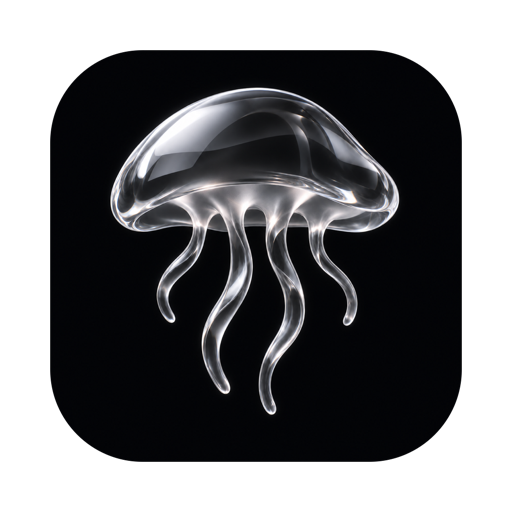
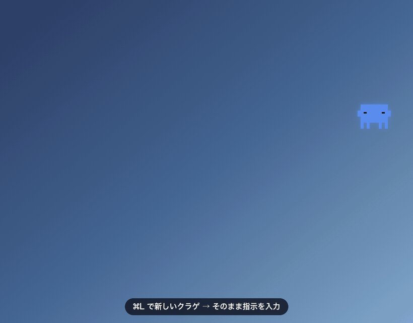
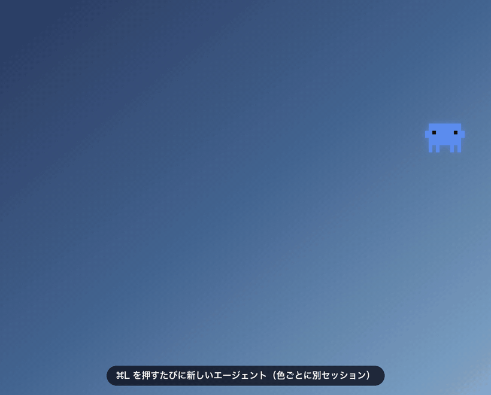
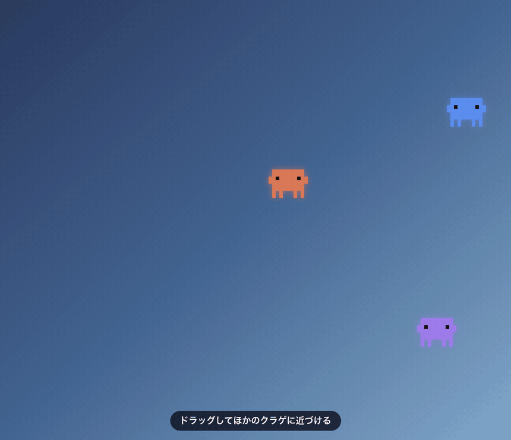
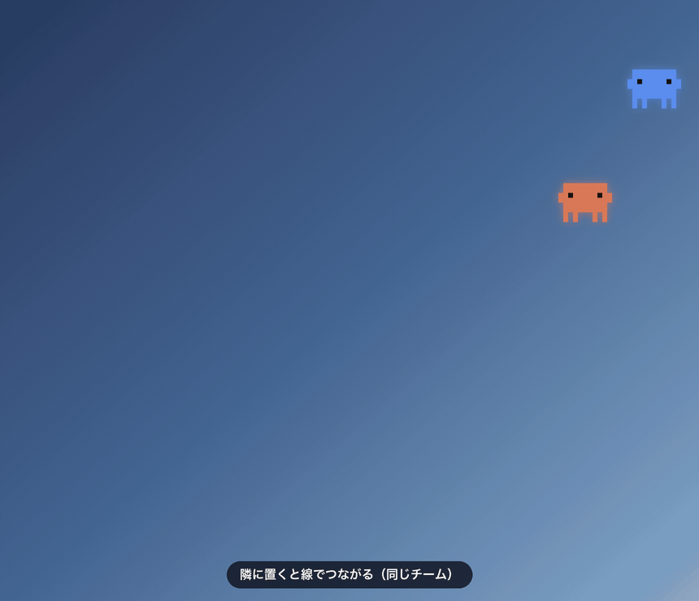
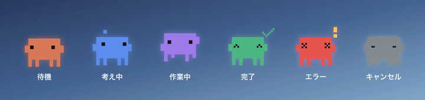
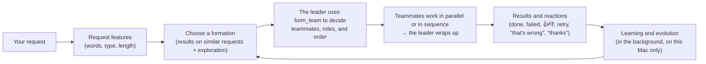

<p align="center">
  
</p>

<h1 align="center">Jellyfish AI</h1>

<p align="center">
  <a href="https://github.com/Rhizobium-gits/jellyfish-ai/actions/workflows/ci.yml"></a>
  <a href="https://github.com/Rhizobium-gits/jellyfish-ai/releases/latest"></a>
  <a href="LICENSE"></a>
  
</p>

<p align="center">
  <a href="README.md">日本語</a> · <b>English</b> · <a href="README.zh-CN.md">简体中文</a>
</p>

<p align="center">
  A macOS app where AI agents live on your desktop, each one running as an independent AI agent (Claude Code).<br>
  Press ⌘L, type, and watch it think, work and finish.
</p>

<p align="center">
  <a href="https://github.com/Rhizobium-gits/jellyfish-ai/releases/latest"><b>⬇︎ Download (.dmg)</b></a>
  &nbsp;·&nbsp; <a href="#download-and-install">Install</a>
  &nbsp;·&nbsp; <a href="#how-to-launch">How to launch</a>
  &nbsp;·&nbsp; <a href="#getting-started">Getting started</a>
  &nbsp;·&nbsp; <a href="#what-it-can-do">What it can do</a>
  &nbsp;·&nbsp; <a href="#ai-engines-and-accounts">AI engines</a>
  &nbsp;·&nbsp; <a href="#autonomous-organization-mode">Autonomous organization mode</a>
  &nbsp;·&nbsp; <a href="#language">Language</a>
</p>

<p align="center">
  
</p>

> [!NOTE]
> This is an unofficial app made by an individual. It is not affiliated with Anthropic, OpenAI or Google. Claude, Claude Code and the Claude Code character belong to Anthropic; ChatGPT and Codex belong to OpenAI; Gemini belongs to Google.

## Download and install

**Requirements**

- macOS 14 or later. It's a universal build that runs on both Apple silicon and Intel (tested on macOS 26 on Apple silicon). Transcribing system audio requires macOS 26 or later
- At least one of these AI CLIs ([AI engines and accounts](#ai-engines-and-accounts)). Claude Code supports the most features
  - [Claude Code](https://code.claude.com/docs/en/setup) (Claude account). Jellyfish AI automatically picks the newest `claude` from your PATH, `~/.local/bin`, Homebrew, and the copy bundled with the VS Code / Cursor extension
  - [Codex CLI](https://github.com/openai/codex) (ChatGPT account) and [Gemini CLI](https://github.com/google-gemini/gemini-cli) (Google account)

1. **Install the CLI of the AI you want to use**
   Install Claude Code, Codex CLI or Gemini CLI by following its official guide. If you use the Claude Code extension for VS Code / Cursor, the `claude` bundled with the extension works as is. You can sign in from the “Accounts & AI” screen that appears the first time you launch the app (AIs you install later can be signed in from the menu bar jellyfish › 🔑 Accounts & AI)
2. **Download**
   Download `JellyfishAI-<version>.dmg` from [the latest release](https://github.com/Rhizobium-gits/jellyfish-ai/releases/latest) (there's also a `.zip` with the same contents)
3. **Move it to the Applications folder**
   Open the .dmg and drag **JellyfishAI** onto the **Applications** folder next to it
4. **Click “Open Anyway” the first time only**
   The first time you open JellyfishAI from the Applications folder, macOS stops it, saying it can't be opened (because it's a personal project that hasn't been notarized by Apple). Close the dialog and click “Open Anyway” near the bottom of **System Settings › Privacy & Security**. From the second time on, it opens normally

To check that the download isn't corrupted, compare the output of `shasum -a 256 JellyfishAI-<version>.dmg` with `SHA256SUMS.txt` from the same release.

> [!IMPORTANT]
> Agents create, edit and delete files and run commands **without asking** (Claude Code's Auto mode and the like; each AI's own safety features stop dangerous operations). The working folder is your home folder by default. For details, see [Permissions and safety](#permissions-and-safety) and [SECURITY.md](SECURITY.md).
>
> Agents run on your AI accounts (Claude Pro / Max, ChatGPT, Google) and consume their usage. **Jellyfish doesn't handle API keys and never charges you on its own** (AIs signed in with an API key / pay-as-you-go aren't used unless you allow it). Claude Code alone uses tens of thousands of tokens per call for its baseline, so running many jellyfish in parallel reaches your usage limits quickly. You can check how much you've used this week from the menu bar jellyfish.

## How to launch

You don't need Terminal. Open it like any other Mac app.

| Where | How |
|---|---|
| **Spotlight** | Press ⌘Space, type “Jellyfish”, and press Enter |
| **Launchpad / Apps** | Click the Jellyfish AI icon |
| **Finder** | Double-click JellyfishAI in the “Applications” folder |
| **Dock** | Drag JellyfishAI from the Applications folder to the Dock, and from then on it's a single click |
| **Automatically at login** | Turn on menu bar jellyfish › **Open at login** |

- Once launched, a pixel-art jellyfish icon appears in the menu bar. Jellyfish AI is a resident app, so it normally doesn't appear in the Dock (it shows up in the Dock and ⌘Tab only while a chat window is open)
- Opening the app icon again while it's running brings back any hidden jellyfish. If there are none, it brings out a new jellyfish
- To quit, choose menu bar jellyfish › **Quit Jellyfish AI** (⌘Q). Running agents are interrupted

## Getting started

1. Press **⌘L** from any app, and a new jellyfish appears with an input field open
2. Write what you want done and press **Enter**. The input field closes, and the jellyfish works while showing its state through its movement (thinking, working, done, error)
3. **Tap** a jellyfish that has finished to read the result in the chat window. You can keep giving instructions right there
4. **Long-press** a jellyfish you no longer need to remove it

On first launch, you'll see a guide to how it works and the permissions given to agents.

## Menu bar

Click the jellyfish in the menu bar, and the top of the menu shows **your Claude Code account and this week's usage** (the same information as the Claude Code extension for VS Code).

- The email and plan of the signed-in account (e.g. Claude Max 20x)
- Bars and percentages for this week's usage: the **all models** and **Fable** limits, each with its reset date and time (orange at 75%, red at 90%)
- When you open the menu, it re-reads them from Claude Code if at least a minute has passed since the last read (`claude auth status` and `claude -p /usage`; `/usage` is a built-in Claude Code command, so no model is called and no tokens are used). It never fetches them periodically in the background

Below that, you'll find New jellyfish, Hide / Show jellyfish, past sessions, and the list of agents, plus settings for Appearance, Size, Screen awareness, 🔑 Accounts & AI, 🧠 Model (default), Execution policy, PC control, Team, 🧬 Autonomous organization, External tools (MCP), Open at login, and 🌐 Language. “About Jellyfish AI” and “Check for updates…” are here too.

## What it can do

- **⌘L for an instant agent**: from any app, ⌘L brings out a new jellyfish, and you can type your instruction right away. Press Enter to send; the input field closes and the jellyfish starts working
- **Its movement shows its state**: thinking, working (running a tool), done, error, and canceled are shown in step with Claude Code's actual events. Once done, it stops moving and uses almost no CPU
- **Parallel and independent**: each jellyfish has its own session, working folder, history, and process. If one fails, the others are unaffected
- **Tap for results and follow-ups**: read the result in the chat window and keep giving instructions in the same session. The window is a normal Mac window (minimize, full screen, resize freely)
- **Pick the model**: at the top of the chat, choose per jellyfish between **🤖 Automatic** (per request: Haiku for short, simple requests, Sonnet for typical ones, Opus for heavy ones; the heaviest requests use Fable only while this week's Fable usage is below 75%) and **Fable / Opus / Sonnet / Haiku**. In Automatic, the status line shows the chosen model and why. Thinking effort (`--effort`) is on the same row. Jellyfish that don't pick a model follow **🧠 Model (default)** in the menu bar
- **See your usage**: the menu bar jellyfish shows your account and this week's usage (all models, Fable) as bars
- **Works while looking at your screen**: when you clearly point at the screen, as in “this screen”, “the error that's showing”, or “screenshot”, it captures the screen at send time and passes it along (Jellyfish's own windows are not captured, and an ordinary instruction like “show me the list” doesn't trigger a capture; you can also switch to “Attach every time” / “Don't attach” in the chat). Images are scaled down to at most 1568px on the long side before sending, so each one costs about 1,800 tokens (about 40% of what it would at 2560px)
- **External tools only when named**: the MCP servers configured in Claude Code (Figma, Blender, etc.) and claude.ai connectors are loaded only when your instruction mentions them by name. Not loading them the rest of the time saves about 4,800 tokens per call and makes startup faster
- **Agents divide the work**: bring a jellyfish close to another one, and the other lights up with “Release to link”; release it, and they're connected by a line and become the same team. Agents can ask teammates to do work or create new teammates to share it, and requests (in the requester's color) and results (in the assignee's color) travel back and forth along the line as light. ⇧-drag moves the whole team; holding ⌥ when you release, or the ✂︎ on the line, cuts the link
- **Autonomous organization mode**: for each request, the agent decides on its own the team shape that suits the work (solo, split, sequential, pick among alternatives, hierarchy + reviewer) and assembles teammates, then learns from the results and from reactions like 👍👎 to evolve how it chooses an organization ([Autonomous organization mode](#autonomous-organization-mode))
- **日本語, English, 简体中文**: switch the display language with 🌐 in the menu bar. Guidance passed to agents is in that language too ([Language](#language))
- **Give them names**: right-click “Rename…” or use “Name” in the chat. Agents call each other by these names. A jellyfish without a name is “Agent N” (a number), and the smallest free number is reused (numbers don't keep growing; if there are gaps, use “Renumber from 1” in the menu bar)
- **Open files and pages**: ask “open the X document on my Desktop”, and it finds it and opens it in the Mac's default app (Preview, Finder, a browser, etc.). Ask “what does it say?” and it answers in the chat
- **Hand over files**: drop a file on a jellyfish or the chat window to attach it (the 📎 button works too)
- **Kept in Claude Code's records**: conversations are saved as Claude Code's own sessions (`~/.claude/projects`), so you can continue them from VS Code or Terminal. With “Open past session” in the menu bar, you can also bring up sessions created in VS Code or Terminal as jellyfish. Hold ⌥ while choosing one to archive it (this only removes it from the list and doesn't delete the record; you can bring it back from “Archived”)

<p align="center">
  
</p>

<p align="center">
  
</p>

<p align="center">
  
</p>

<p align="center">
  
</p>

## Controls

| Action | What it does |
|---|---|
| **⌘L** (from any app) | Bring out a new jellyfish and open the input field right away |
| **Tap** | Open the chat window (Enter to send / ⇧Enter for a new line / Esc to close) |
| **↑ / ↓** (input field) | Recall instructions sent earlier in that session (↑ on the first line, ↓ on the last line; includes instructions typed in VS Code or Terminal; going past the newest one returns to your draft) |
| **Long-press** | Remove that jellyfish (if it's working, asks you to choose “Keep Working, Remove Only the Jellyfish” or “Cancel Work and Remove”) |
| **Drag** | Move it anywhere (the position is saved). Drop it near another jellyfish to link them |
| **⇧-drag** | Move the whole team connected by lines |
| **Hold ⌥ when releasing** | Cut all of that jellyfish's links |
| **Right-click** | Chat, name, connect / disconnect, cancel, hide, reset position, delete |
| **⌥⌘L** / menu bar | Hide / show all (work continues while hidden) |

The bottom row of the chat window lets you change the model, effort, screen attachment (Auto-detect / Attach every time / Don't attach), file attachments, and working folder. “Open in Claude Code” opens the same session in Terminal with `claude --resume`.

### PC control

Only agents with **🖱 PC Control** turned on in the chat can control this Mac using Jellyfish's MCP tools (off by default).

- `screen_capture` (captures at 1 pixel = 1 point, so coordinates in the image are directly the click coordinates), `list_windows`, `ui_elements` (reads the positions of buttons and input fields through accessibility), `open_app`, `mouse_click`, `mouse_drag`, `scroll`, `type_text`, `press_keys`
- Only one agent can control the Mac at a time. While it's in control, the edges of the screen glow in that agent's color, and **Esc stops it** (you can also stop it from “PC control” in the menu bar)
- These tools aren't pre-approved; every call goes through Claude Code's Auto Mode safety checks. Agents are instructed not to enter passwords, make payments, send messages, or post publicly unless the user explicitly asks
- Allow Jellyfish AI under **Accessibility** and **Screen Recording** in “System Settings › Privacy & Security”
- The edges also glow while the tools that only read the screen (`screen_capture`, `list_windows`, `ui_elements`) are in use, and Esc stops them. `open_app` can only open http / https URLs
- macOS permissions apply to the whole app, so even for agents with the switch off, commands that Claude Code runs (such as `screencapture`) can act within those permissions. Remove the permissions when you no longer use them
- For Blender, if you've added the Blender MCP to Claude Code, agents can use it when your instruction says “Blender” ([External tools (MCP) only when named](#external-tools-mcp-only-when-named))

### Listen (transcription, translation, meeting minutes)

Press **🎧** in the chat to transcribe the audio playing on your Mac (online meetings, videos, etc.; Jellyfish's own sounds are excluded) as it plays. Transcription is processed on-device with macOS 26's SpeechAnalyzer (the OS downloads a language model the first time only), and saved to a text file with timestamps.

- When you stop, the transcript is attached to the chat, so you can follow up with “write up the meeting minutes”, “translate it into Japanese”, or “make it into a report in Word”
- Agents can also read the transcript while listening is still in progress with `read_transcript`, so real-time translation and summaries work too (they can also read their teammates' transcripts)
- Put an agent that writes the report and one that edits it on a team, and you can run “write → review → revise” all the way through (.docx files can be made with pandoc or python-docx)
- Capturing the audio requires the **Screen Recording** permission. macOS 26 or later

### External tools (MCP) only when named

The MCP servers configured in Claude Code (the ones in `~/.claude.json` or a project's `.mcp.json`, such as Figma and Blender) and claude.ai connectors add to the baseline token count every time they're loaded. So Jellyfish normally runs with the official `--strict-mcp-config` option, using only its own MCP (team, PC control).

- If your instruction includes a server name, such as “Blender”, “ブレンダー”, “Figma”, or “フィグマ”, they're loaded from that turn on. Follow-ups in the same conversation (such as “make it a bit bigger”) keep them loaded
- A name merely appearing in a request from a teammate doesn't load them. A teammate loads them only when the requester itself loaded them because of the user's instruction (so that a teammate steered by a web page or the like can't make other teammates use external tools)
- On turns where they weren't loaded, the agent is told in one line: “External tools aren't loaded. If they're needed, ask the user to resend the request including the name”
- In the menu bar, “External tools (MCP)” switches between “Only when named / Always load / Don't use”. When they're loaded, the chat's status area shows 🧩 and the names

Measured (Haiku 5.5, one run of “Reply with just OK”): loaded 39,945 tokens, 3.8 s → not loaded 35,139 tokens, 2.9 s.

### Team (division of labor)

1. Drag a jellyfish **close to** another one, and the other glows with a dotted ring and shows “Release to link with X”. Release it, and it slides to a distance where the line is visible and they link. A connected cluster is one team
   - You can also link jellyfish that are far apart with right-click › Connect
   - Hold ⇧ while dragging to move the whole team (if you let go of ⇧ before releasing, the teammates return to their original positions)
   - “👥 Team with X” appears at the top of the chat window, so you can see whom you can hand work to
2. Ask any of them something like “create teammates and split the work” or “have a reviewer check it”. The agent uses Jellyfish's MCP tools:
   - `create_teammate`: brings out a new teammate next to itself and hands it work (the working folder and model are inherited)
   - `assign_task`: asks a teammate on the team to do work (if the teammate is busy, the request waits in line)
   - `wait_for_tasks`: receives the results of the requested work
   - `list_team`: shows the teammates and their states
3. The chat of the jellyfish that was asked keeps it as “📨 Request from X”. The result goes back to the requester, who wraps it up
4. Links can be cut with the ✂︎ that appears when you hover over the line, by holding ⌥ while you drag and release (the line turns red and shows “Release to cut links”), or with right-click › Connections

Up to 8 jellyfish per team. Teammates created by an agent can create teammates only one more level down (two levels counting from your jellyfish). You can turn off the whole feature with “Team (division of labor)” in the menu bar.

## Autonomous organization mode

Turn on menu bar jellyfish › **🧬 Autonomous organization › Autonomous organization mode**, and for every request the agent **assembles an organization suited to the work on its own** and gets it done (off by default; Team (division of labor) is turned on along with it).



**Formations** (`formation` in `form_team`)

| Formation | Example | Suited to |
|---|---|---|
| Solo `solo` | | Small requests that are hard to split |
| Solo + reviewer `solo+r` | Write → edit | Writing, code, translation |
| Split and run in parallel `parallel2〜5` | Research 5 companies, one each | Requests that split into independent parts |
| In sequence `pipeline2〜4` | Research → write → verify | Requests where each step uses the previous result |
| Try separately and pick the best `ensemble2〜3` | Come up with 3 ideas and pick one | Ideas, design |
| Hierarchy `hierarchy2〜3` | Sub-leads split the work further | Large, broad requests |

A `+r` after a formation means a reviewer is placed at the end to look at everyone's results.

**How it works**

1. When a request comes in, Jellyfish picks a recommended formation from the request's features (words, type of request, length; in Japanese, English, or Chinese) based on past results, and tells the leader (the jellyfish you asked)
2. The leader uses `form_team` to decide the teammates' names, roles, and tasks, and assembles them. If an order is set with `after`, the previous member's result is automatically attached to the next member's request. If another formation fits better than the recommendation, the leader can change it
3. The teammates appear next to it, connected by lines, and work in parallel or in sequence. The chat's status area shows 🧬 and the formation in use
4. Teammates not used in the next request are cleaned up (teammates with the same name keep being used). You can also clean them up with “Disband current organization” in the menu

**Learning and evolution** (in the background, on-device)

- For each request, it gives a score from 0 to 1 based on the results (done or failed, time taken, whether the teammates succeeded) and your reactions (👍 / 👎 in the chat, rerunning or canceling, and follow-ups such as “that's wrong”, “redo it”, “thanks”, or “perfect”)
- It keeps an estimate for each formation as a Beta distribution and chooses while weighting **similar requests more strongly** (Thompson sampling). It uses formations that work well, while occasionally trying others to learn
- **New kinds of requests** (with no similar ones yet) are matched to a formation from the expectation for that type of request and the overall trend, and it learns from the result
- Slight variations of well-performing formations (number of members, with or without a reviewer, shape) are born, and clearly poor formations retire (“Solo” always stays). The generation, the number of formations, and the best formation for each type of request appear in the menu, with details in “Open learning report”
- Records are saved only in `~/Library/Application Support/JellyfishAI/org/` and are never sent anywhere. You can erase them with “Reset learning…”. Turning off “Learn from results and reactions” stops recording (choices still use what has been learned so far)

> [!NOTE]
> Each teammate adds to your Claude Code usage. For small requests, agents are guided to proceed solo, and formations with more members are slightly discounted when choosing. PC control tools are never given to teammates (only to the agent the user asked directly).

## Language

From menu bar jellyfish › **🌐 言語 · Language · 语言**, you can choose **日本語 / English / 简体中文 / Automatic (follow the system)**.

- Menus, chats, guides, and other display text switch immediately (open chats are rebuilt)
- Guidance passed to agents (team, PC control, autonomous organization, etc.) is also in that language, so replies tend to be in that language too
- Automatic follows macOS's “Preferred Languages” (English if it's none of Japanese, English, or Chinese)
- Detecting words that point at the screen (“この画面”, “this screen”, “这个屏幕”, etc.), as well as reading request types and reactions for autonomous organization, works in all three languages

## AI engines and accounts

You can choose which AI runs your agents: **Claude (Claude Code), ChatGPT (Codex CLI) or Gemini (Gemini CLI)**. Each one runs the official CLI installed on this Mac, **signed in with your own account**.

| AI | CLI | Account to sign in with | Rules when running without asking | Features |
|---|---|---|---|---|
| Claude | Claude Code | Claude (Pro, Max, etc.) | Auto mode (Claude Code's safety checks stop dangerous operations) | All |
| ChatGPT | Codex CLI | ChatGPT (Plus, Pro, etc.) | Sandbox (can write only inside the working folder, no network) | Chat, work, continue |
| Gemini | Gemini CLI | Google account | auto_edit (auto-approves only edits inside the working folder, doesn't run commands) | Chat, work, continue |

- **The first time you launch the app**, the “Accounts & AI” screen appears so you can sign in to each AI. For AIs that aren't installed, “How to install…” shows the official install command (Jellyfish doesn't install anything for you)
- **Later**, add accounts, sign in again with another account, or change the AI you use from the menu bar jellyfish › **🔑 Accounts & AI**. The sign-in status (✓ / ⚠️) is shown there too
- **You can choose the AI per jellyfish**: “AI” at the top of the chat. Changing it starts a new conversation. Jellyfish that don't pick one follow “AI to use” in the menu. Teammates run on the same AI as the jellyfish that created them
- Signing in opens each CLI's official sign-in (`claude auth login --claudeai`, `codex login`, Gemini CLI's “Sign in with Google”) in Terminal, and you sign in yourself in the browser. **Jellyfish never receives or stores passwords, tokens or API keys**
- Team (division of labor), PC control, autonomous organization, external tools (MCP) and the “Automatic” model are Claude only. Codex and Gemini use their CLI's default model
- Gemini checks whether it trusts a folder and won't run in an untrusted one. Open it with “Open Gemini in this folder” in the chat and trust the folder only if it's one you trust (Jellyfish never skips this check)

### No surprise charges

- Jellyfish **doesn't use API keys (pay-as-you-go)**. This applies to Claude too
  - Even if your shell settings contain `ANTHROPIC_API_KEY`, `OPENAI_API_KEY`, `CODEX_API_KEY`, `GEMINI_API_KEY`, `GOOGLE_API_KEY` and the like, they aren't passed to the agents' CLIs
  - If a CLI is signed in with an API key or a cloud provider (Anthropic Console, Bedrock, Vertex AI, etc.), that jellyfish won't run, and you're asked to sign in again with a subscription account
- Only if you really want to use an API key, turn on menu bar jellyfish › 🔑 Accounts & AI › “Allow use with API keys (pay-as-you-go)” (you'll be asked to confirm; each API bills you for what you use)
- Purchasing extra usage beyond your subscription limits stays as set in each account (Jellyfish doesn't change it)

## Updates

- Menu bar jellyfish › **Check for updates…** checks GitHub for a newer version (only when you choose it; it never connects automatically)
- If there's a new version, download the .dmg and replace the app by dragging it to the Applications folder, the same as in [Install](#download-and-install) (settings, jellyfish, and conversations are kept)
- If you use PC control or screen attachment after replacing it, grant the Screen Recording and Accessibility permissions again ([Good to know](#good-to-know))

### Stop being asked for permissions after every update

To stop macOS from asking for permissions after every update, run these commands once in Terminal (in the folder where you put the source; if you haven't yet, do the `git clone` in [Build from source](#build-from-source) first).

```bash
cd ~/jellyfish-ai
scripts/signing.sh create
scripts/install.sh
```

> [!IMPORTANT]
> In the signing confirmation dialog, choose **Allow**. If you choose **Always Allow**, other programs can also use this certificate without asking.

- `scripts/signing.sh create` creates a Jellyfish-only signing certificate (self-signed) in your login keychain, and `scripts/install.sh` signs the app with it and installs it. macOS treats "Jellyfish AI signed with the same certificate" as the same app, so folder (Desktop, Documents, …), Screen Recording and Accessibility permissions carry over to later updates
- You'll be asked for the permissions once more, only the first time after switching to the certificate
- Install later updates with `git pull` followed by `scripts/install.sh` too (the .dmg builds are ad-hoc signed, so replacing the app with one asks for the permissions again)
- Check it with `scripts/signing.sh status`; stop using it with `scripts/signing.sh delete`

## Build from source

No Xcode needed; you can build with just the Swift in Command Line Tools (5.10 or later, tested with 6.3).

```bash
git clone https://github.com/Rhizobium-gits/jellyfish-ai.git
cd jellyfish-ai
scripts/install.sh          # build, install to the Applications folder, and launch
```

- Create a signing certificate with `scripts/signing.sh create` first, and macOS permissions (folders, Screen Recording, Accessibility) carry over when you reinstall ([Good to know](#good-to-know))
- Once installed with `scripts/install.sh`, you can open it without Terminal like any other app. It quits the running Jellyfish AI before replacing it (if any agent is working, it does nothing)
- To build only, use `scripts/build.sh` (→ `dist/JellyfishAI.app`, for this Mac's CPU); to run the tests, use `scripts/test.sh` (swift test)
- The app icon is made by fitting `Resources/AppIcon.png` (a 1024px square) into the rounded frame of macOS icons. Replace it and rebuild to change the icon
- Distribution files are made in `dist/release/` with `scripts/release.sh` (universal .dmg, .zip, SHA256SUMS.txt). Update `VERSION` and `CHANGELOG.md`, commit and push, then publish to GitHub Releases with `scripts/release.sh --publish`

## Permissions and safety

- Jellyfish doesn't handle API keys and never charges you on its own. AIs signed in with an API key (pay-as-you-go) aren't used, and API key environment variables aren't passed ([No surprise charges](#no-surprise-charges))
- Agents run in Claude Code's official **Auto Mode** (`--permission-mode auto`). They go ahead with file operations and commands without asking, and Claude Code's safety checks stop things like exfiltrating credentials, unintended sending to outside services, and irreversible operations. Options are passed only after checking at launch that they exist in `claude --help`
- You can check the current scope of permissions and the location and version of the `claude` in use under “Execution policy” in the menu bar
- It doesn't change macOS permission settings. Only when you use screen awareness, allow Jellyfish AI under “System Settings › Privacy & Security › Screen Recording”
- Jellyfish AI's own network access is limited to reading GitHub's public API once when you choose “Check for updates…” (no automatic checks, no usage reporting). Instructions and attachments are sent to Anthropic through Claude Code. The usage in the menu is read from Anthropic by Claude Code when you open the menu
- Modes that turn off the safety checks, such as `bypassPermissions`, are not used even if they're written in `settings.json`
- PC control is used only when you ask directly in that agent's chat (never for requests from teammates)
- External control through `jellyfish://` URLs accepts only harmless actions such as toggling the display (it doesn't accept sending instructions, granting PC control, and so on; rapid-fire calls are throttled, and it doesn't steal keyboard focus)
- The .app is signed with Hardened Runtime enabled (so other programs can't inject into the app and use permissions such as Screen Recording)
- Autonomous organization learning is computed only on-device, and its records (`org/`) are saved with permissions that only you can read
- For details, see [SECURITY.md](SECURITY.md). Please report vulnerabilities privately through the Security tab

## Good to know

- Because ⌘L is used globally, it conflicts with jumping to the address bar in browsers. While an app whose bundle ID is listed in `hotKeyPassthroughApps` in `settings.json` is in front, ⌘L is passed back to that app. If another app is already using ⌘L, it switches to ⌃⌥L
- Quitting the app interrupts running agents (they're kept as “interrupted” at the next launch)
- The released .app is ad-hoc signed, so when you replace it with a new version macOS treats it as a different app and asks again for folder (Desktop, Documents, …), Screen Recording and Accessibility access. For Screen Recording and Accessibility, remove Jellyfish AI (−) in System Settings once and allow it again
- If you install from source, create a Jellyfish-only signing certificate (self-signed) with `scripts/signing.sh create` first. `scripts/install.sh` then signs with it, and **a permission you grant once stays granted** even after rebuilding (and you won't be asked again each time you add a jellyfish). The private key is imported as non-exportable, and macOS asks you to confirm each time the key is used for signing. Check it with `scripts/signing.sh status`, remove it with `delete`

## Where data is stored

`~/Library/Application Support/JellyfishAI/` (settings, jellyfish, each agent's history and raw events, transcripts, autonomous organization learning, logs; the folder has permissions that only you can open). You can open it with “Open settings folder” in the menu bar. Screen images passed to agents are deleted after 7 days, and removing a jellyfish also deletes its raw events and images. The conversations themselves remain as Claude Code sessions in `~/.claude/projects/`. Launch with the environment variable `JELLYFISH_DATA_DIR` set to use a different location (for demo recording and testing).

### Uninstall

1. From the menu bar jellyfish, turn off “Open at login”, then choose “Quit Jellyfish AI”
2. Move JellyfishAI from the Applications folder to the Trash
3. To delete the data as well, delete `~/Library/Application Support/JellyfishAI/` (for things like window positions, run `defaults delete ai.jellyfish.desktop`)
4. Permissions you granted can be removed under each item (Screen Recording, Accessibility) in “System Settings › Privacy & Security”

Claude Code sessions (`~/.claude/projects/`) belong to Claude Code, so they remain even after you remove Jellyfish.

## Development

- Design notes: [docs/ARCHITECTURE.md](docs/ARCHITECTURE.md)
- You can control it from outside with the `jellyfish://` URL scheme
  - Anytime (Shortcuts.app, Raycast, etc.): `new`, `open?agent=2`, `toggle`, `show`, `hide`, `arrange`, `style?v=pixel|realistic`, `scale?v=1.25`
  - Only when launched with the environment variable `JELLYFISH_AUTOMATION=1` and the passphrase from `automation.token` in the data folder is added as `token=…` (for automated tests and demo recording; `scripts/demo/recorder.swift` adds it automatically): `renumber`, `prompt?agent=2&text=…`, `type?agent=2&text=…`, `new?cwd=…`, `folder?agent=2&path=…`, `pc?agent=2&on=1`, `rename?agent=2&name=…`, `link?a=2&b=3`, `unlink?a=2&b=3`, `move?agent=2&dx=…`, `press?agent=2`, `accounts`, `state?agent=2&s=working`, `remove?agent=2`, `login?on=1`, `debug`
- `.build/debug/JellyfishAI --pixel-sheet out.png` renders a sheet of the pixel-art frames, `--settle-test` verifies that it comes to rest when done, and `--account-menu out.png` renders the account and usage section of the menu (actually reading from claude)
- Display text is written in Japanese in the source and wrapped in `L("…")`, with translations in `l10n/en.json` and `l10n/zh.json`. `scripts/l10n.py missing en` lists missing translations, `scripts/l10n.py gen` generates the Swift tables, and `scripts/l10n.py check` checks for missing translations and the number of `%@` (also checked in CI). Launch with the environment variable `JELLYFISH_LANGUAGE=en` to fix the language
- The README GIFs can be re-recorded with `scripts/demo/record.sh` (it doesn't touch your everyday data; it actually runs Claude Code with empty demo data and records it. Requires Pillow and ffmpeg)

## License

[MIT](LICENSE). See [CHANGELOG.md](CHANGELOG.md) for the change history.
