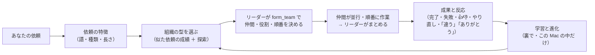

<p align="center">
  
</p>

<h1 align="center">Jellyfish AI</h1>

<p align="center">
  <a href="https://github.com/Rhizobium-gits/jellyfish-ai/actions/workflows/ci.yml"></a>
  <a href="https://github.com/Rhizobium-gits/jellyfish-ai/releases/latest"></a>
  <a href="LICENSE"></a>
  
</p>

<p align="center">
  <b>日本語</b> · <a href="README.en.md">English</a> · <a href="README.zh-CN.md">简体中文</a>
</p>

<p align="center">
  デスクトップ上にAIエージェントが常駐し、1 体ずつが独立した AI エージェント（Claude Code）として動く macOS アプリです。<br>
  <i>A macOS desktop companion: each little pixel character on the edge of your screen is an independent Claude Code agent.<br>Press ⌘L, type, and watch it think, work and finish.</i>
</p>

<p align="center">
  <a href="https://github.com/Rhizobium-gits/jellyfish-ai/releases/latest"><b>⬇︎ ダウンロード（.dmg）</b></a>
  &nbsp;·&nbsp; <a href="#ダウンロードとインストール">インストール</a>
  &nbsp;·&nbsp; <a href="#起動のしかた">起動のしかた</a>
  &nbsp;·&nbsp; <a href="#はじめかた">はじめかた</a>
  &nbsp;·&nbsp; <a href="#できること">できること</a>
  &nbsp;·&nbsp; <a href="#使う-ai-とアカウント">使う AI</a>
  &nbsp;·&nbsp; <a href="#自律組織モード">自律組織モード</a>
  &nbsp;·&nbsp; <a href="#言語">言語</a>
</p>

<p align="center">
  
</p>

> [!NOTE]
> 個人が作った非公式のアプリです。Anthropic・OpenAI・Google とは関係ありません。Claude・Claude Code および Claude Code のキャラクターは Anthropic の、ChatGPT・Codex は OpenAI の、Gemini は Google のものです。

## ダウンロードとインストール

**必要なもの**

- macOS 14 以降。Apple シリコン / Intel の両方で動く universal 版です（動作確認は Apple シリコンの macOS 26）。システムの音の文字起こしは macOS 26 以降
- 次の AI の CLI のどれか 1 つ以上（[使う AI とアカウント](#使う-ai-とアカウント)）。いちばん多くの機能が使えるのは Claude Code です
  - [Claude Code](https://code.claude.com/docs/en/setup)（Claude のアカウント）。PATH・`~/.local/bin`・Homebrew・VS Code / Cursor 拡張に同梱の `claude` から最新版を自動で選びます
  - [Codex CLI](https://github.com/openai/codex)（ChatGPT のアカウント）・[Gemini CLI](https://github.com/google-gemini/gemini-cli)（Google アカウント）。ChatGPT のデスクトップアプリに入っている Codex CLI も自動で見つけ、アプリで ChatGPT にログインしていればそのまま使えます

1. **使う AI の CLI を入れる**
   Claude Code・Codex CLI・Gemini CLI のどれかを、それぞれの公式の案内に沿って入れます。VS Code / Cursor の Claude Code 拡張を使っているなら、拡張に同梱の `claude` をそのまま使えます。ログインは、初めて起動したときに出る「アカウントと AI」の画面からできます（あとから入れた AI も、メニューバーのクラゲ › 🔑 アカウントと AI でログインできます）。まだ入っていない AI も、その画面やメニューの「入れてログイン…」から、許可すれば公式のパッケージを入れてそのままログインまで進めます
2. **ダウンロード**
   [Releases の最新版](https://github.com/Rhizobium-gits/jellyfish-ai/releases/latest) から `JellyfishAI-<版>.dmg` をダウンロードします（`.zip` もあります。中身は同じ）
3. **アプリケーションフォルダに入れる**
   .dmg を開き、**JellyfishAI** を隣の **Applications** へドラッグします
4. **初回だけ「このまま開く」**
   アプリケーションフォルダの JellyfishAI を開くと、初回だけ macOS が「開けません」と止めます（Apple の公証を受けていない個人の開発物のため）。ダイアログを閉じ、**システム設定 › プライバシーとセキュリティ** の下の方にある「このまま開く」を押してください。2 回目からは普通に開けます

ダウンロードしたファイルが壊れていないかは、同じリリースの `SHA256SUMS.txt` と `shasum -a 256 JellyfishAI-<版>.dmg` の結果を見比べて確かめられます。

> [!IMPORTANT]
> エージェントは **確認なしで** ファイルの作成・編集・削除やコマンドの実行を行います（Claude Code の Auto モードなど。危ない操作はそれぞれの AI の安全の仕組みが止めます）。作業フォルダは既定でホームです。詳しくは [権限と安全](#権限と安全) と [SECURITY.md](SECURITY.md)。
>
> エージェントは あなたの AI のアカウント（Claude の Pro / Max、ChatGPT、Google のアカウント）で動き、その使用量を消費します。**Jellyfish は API キーを扱わず、勝手に課金しません**（API キー・従量課金でログインしている AI は、許可しない限り使いません）。Claude Code は 1 回の呼び出しの土台だけで数万トークンを使うので、たくさんのクラゲを並列に動かすと使用量の上限に早く届きます。今週どれだけ使ったかはメニューバーのクラゲで確かめられます。

## 起動のしかた

ターミナルは要りません。普通の Mac のアプリと同じように開けます。

| どこから | やり方 |
|---|---|
| **Spotlight** | ⌘Space で「Jellyfish」と打って Enter |
| **Launchpad / アプリ** | Jellyfish AI のアイコンをクリック |
| **Finder** | 「アプリケーション」フォルダの JellyfishAI をダブルクリック |
| **Dock** | アプリケーションフォルダの JellyfishAI を Dock へドラッグしておくと、次からはクリックだけ |
| **ログイン時に自動で** | メニューバーのクラゲ › **ログイン時に自動起動** をオン |

- 起動すると、メニューバーにドット絵のクラゲのアイコンが出ます。Jellyfish AI は常駐型のアプリなので、普段は Dock に出ません（チャットウィンドウを開いている間だけ Dock と ⌘Tab に出ます）
- 動いている最中にもう一度アイコンを開くと、隠していたクラゲを出します。1 体もいなければ新しいクラゲを出します
- 終了はメニューバーのクラゲ › **Jellyfish AI を終了**（⌘Q）。実行中のエージェントは中断されます

## はじめかた

1. どのアプリを使っていても **⌘L** を押すと、新しいクラゲが現れて入力欄が開きます
2. やってほしいことを書いて **Enter**。入力欄が閉じ、クラゲが動きで状態を見せながら作業します（考え中・作業中・完了・エラー）
3. 終わったクラゲを **タップ** すると、チャットウィンドウで結果を読めます。そのまま続けて指示できます
4. 要らなくなったクラゲは **長押し** で消せます

初回の起動では、使い方とエージェントに与える権限の案内が出ます。

## メニューバー

メニューバーのクラゲをクリックすると、いちばん上に **Claude Code のアカウントと今週の使用量** が出ます（VS Code の Claude Code 拡張と同じ情報）。

- ログインしているアカウントのメールとプラン（例：Claude Max 20x）
- 今週の使用量のバーとパーセンテージ：**全モデル** と **Fable** の枠、それぞれのリセット日時（75% でオレンジ、90% で赤）
- **📊 使用量（AI ごと・直近 7 日）**：Claude・ChatGPT（Codex）・Gemini それぞれの、モデルごと・アカウントごとの呼び出しの回数とトークン（Jellyfish が動かした分を、CLI が報告した数で。この Mac の中だけで数えます）。Claude は今週の上限の％、ChatGPT は 5 時間・今週の枠の％も
- メニューを開いたときに、前に読んでから 1 分以上たっていれば Claude Code から読み直します（`claude auth status` と `claude -p /usage`。`/usage` は Claude Code の組み込みコマンドなので、モデルは呼ばずトークンも使いません）。裏で定期的に取りに行くことはしません

その下で、新しいクラゲ・全員を隠す / 表示・過去のセッション・エージェントの一覧と、見た目・大きさ・画面認識・🔑 アカウントと AI・🧠 モデル（既定）・実行ポリシー・PC 操作・チーム・🧬 自律組織・外部ツール（MCP）・チャットの Web ページのプレビュー・ログイン時の自動起動・🌐 言語を設定できます。「Jellyfish AI について」「アップデートを確認…」もここにあります。

## できること

- **⌘L で即エージェント**：どのアプリを使っていても ⌘L で新しいクラゲが現れ、そのまま指示を打てる。Enter で送信すると入力欄は閉じ、クラゲが作業を始める
- **動きで状態がわかる**：考え中・作業中（ツール実行中）・完了・エラー・キャンセルを、Claude Code の実際のイベントに合わせて表示。完了したら動きが止まり、CPU をほぼ使わない
- **並列・独立**：クラゲごとに別のセッション・作業フォルダ・履歴・プロセス。1 体が失敗しても他は影響を受けない
- **タップで結果と続き**：チャットウィンドウで結果を読み、同じセッションのまま続けて指示できる。ウィンドウは普通の Mac のウィンドウ（しまう・フルスクリーン・自由にリサイズ）
- **モデルを選べる**：チャットの上の段で、クラゲごとに **🤖 自動**（依頼ごとに、短い・簡単なら Haiku、ふつうは Sonnet、重い依頼は Opus。いちばん重い依頼は、今週の Fable の使用量が 75% 未満のときだけ Fable）か、**Fable / Opus / Sonnet / Haiku** を自分で選ぶ。自動のときは状態欄に選んだモデルと理由が出る。考える強さ（`--effort`）も同じ段で。**ChatGPT（Codex）・Gemini のクラゲ** では、その CLI が出すモデルの一覧（`codex debug models`・`gemini models`。名前を推測しない）から選べ、ChatGPT はそのモデルが対応している考える強さ（low〜ultra など）も選べる。選んでいないクラゲはメニューバーの **🧠 モデル（既定）** に従う（AI ごとに既定を決められる）
- **使用量が見える**：メニューバーのクラゲに、Claude のアカウントと今週の使用量（全モデル・Fable）がバーで出る。ChatGPT（Codex）にログインしていれば、そのプラン（例：ChatGPT Plus）と **5 時間・今週の枠の％** もバーで（Codex CLI が自分の記録に書いた、最後に使ったときの値を読むだけ。モデルは呼ばない）。Gemini にログインしていれば、Jellyfish から動かした回数（今日・7 日）
- **画面を見て作業**：「この画面」「表示されているエラー」「スクショ」のように画面をはっきり指すと、送信時の画面を撮って渡す（Jellyfish 自身のウィンドウは写さない。「一覧を表示して」のような普通の指示では撮らない。チャットで「毎回 / しない」にも切り替えられる）。画像は長辺 1568px までに縮めて送るので、1 枚あたり約 1,800 トークン（2560px のときの約 4 割）
- **外部ツールは呼んだときだけ**：Claude Code に設定してある MCP サーバー（Figma・Blender など）と claude.ai のコネクタは、指示に名前が出てきたときだけ読み込む。普段は読み込まないぶん 1 回あたり約 4,800 トークン少なく、起動も速い
- **エージェント同士で分業**：クラゲを別のクラゲに近づけると相手が光って「離すとつながる」と出て、離すと線でつながり同じチームになる。エージェントは仲間に作業を頼んだり、新しい仲間を作って分担させたりでき、依頼（依頼元の色）と結果（依頼先の色）が線の上を光って行き来する。⇧ ドラッグでチームごと移動、⌥ を押しながら離すか線の ✂︎ で切れる
- **自律組織モード**：依頼ごとに、エージェントが仕事に合ったチームの形（一人で・分担・順番・別案から選ぶ・階層 ＋ レビュー係）を自分で決めて仲間を組み、結果と 👍👎 などの反応から組織の選び方を学んで進化させる（[自律組織モード](#自律組織モード)）
- **日本語・English・简体中文**：メニューバーの 🌐 で表示の言語を切り替え。エージェントへの案内もその言語で渡す（[言語](#言語)）
- **名前を付けられる**：右クリック「名前を変える…」かチャットの「名前」。エージェント同士はこの名前で呼び合う。名前のないクラゲは「Agent 番号」で、番号は空いている一番小さいものを使い回す（増え続けない。飛んでいたらメニューバーの「番号を 1 から振り直す」）
- **ファイルやページを開く**：「デスクトップの〇〇の資料を開いて」と頼むと、探して Mac の既定のアプリ（プレビュー・Finder・ブラウザなど）で開く。「何て書いてある？」ならチャットで答える
- **ファイルを渡す**：クラゲやチャットウィンドウにファイルをドロップすると添付になる（📎 ボタンでも可）
- **画像・PDF・Web ページをチャットで見る**：添付した画像・PDF や、会話に出てきた画像・PDF のファイル（パス）は Quick Look のサムネイルで、Web ページの URL は表紙の画像とタイトル（Mac の LinkPresentation。メッセージなどのリンクのプレビューと同じ）で、文の下に出る。押すとプレビュー・ブラウザで開く。エージェントの返答に出てきた Web ページは、「表紙を見る」を押したときだけ読みに行く（読み込んだページなどに仕込まれた指示で、秘密を入れた URL を書かされても、勝手に送らないように）。Web のプレビューはメニューバーの「チャットに Web ページのプレビューを出す」で止められる（画像・PDF はこの Mac の中だけで表示）
- **話して入力（音声入力）**：チャットの **🎙** か メニューの 編集 › **音声入力を開始** で、Mac の音声入力が入力欄で始まり、話した言葉がそのまま文字になる。AI で聞き取るのではなく macOS の機能（システム設定 › キーボード › 音声入力。そこで決めたショートカットでも始められる）
- **Claude Code の記録に残る**：会話は Claude Code 自身のセッション（`~/.claude/projects`）に保存されるので、VS Code やターミナルからも続きを開ける。メニューバーの「過去のセッションを開く」で、VS Code・ターミナルで作ったセッションもクラゲとして呼び出せる。⌥ を押しながら選ぶとアーカイブ（一覧から外すだけで記録は消さない。「アーカイブ済み」から戻せる）

<p align="center">
  
</p>

<p align="center">
  
</p>

<p align="center">
  
</p>

<p align="center">
  
</p>

## 操作

| 操作 | 動作 |
|---|---|
| **⌘L**（どのアプリからでも） | 新しいクラゲを出して、すぐ入力欄を開く |
| **タップ** | チャットウィンドウを開く（Enter 送信 / ⇧Enter 改行 / Esc 閉じる） |
| **↑ / ↓**（入力欄） | そのセッションで前に送った指示を呼び出す（1 行目で ↑・最後の行で ↓。VS Code・ターミナルで打った指示も含む。いちばん新しいものの次は書きかけに戻る） |
| **長押し** | そのクラゲを消す（作業中なら「作業は続ける / キャンセルして消す」を確認） |
| **ドラッグ** | 好きな場所へ移動（位置は保存）。別のクラゲに近づけて離すとつながる |
| **⇧ ドラッグ** | 線でつながったチームごと移動 |
| **⌥ を押しながら離す** | そのクラゲのつながりを全部切る |
| **右クリック** | チャット・名前・つなぐ / つながりを切る・キャンセル・隠す・定位置に戻す・削除 |
| **⌥⌘L** / メニューバー | 全員を隠す・表示（隠しても作業は続く） |

チャットウィンドウの下段では、モデル・強さ・画面の添付（自動判定 / 毎回 / しない）・ファイル添付・作業フォルダを変えられます。「Claude Code で開く」で同じセッションをターミナルの `claude --resume` で開けます。

### PC 操作

チャットの **🖱 PC 操作** をオンにしたエージェントだけが、Jellyfish の MCP ツールでこの Mac を操作できます（既定はオフ）。

- `screen_capture`（1 ピクセル = 1 ポイントで撮るので、画像の座標がそのままクリック座標になる）、`list_windows`、`ui_elements`（アクセシビリティでボタンや入力欄の位置を読む）、`open_app`、`mouse_click`、`mouse_drag`、`scroll`、`type_text`、`press_keys`
- 同時に操作できるのは 1 体だけ。操作中は画面の縁がそのエージェントの色で光り、**Esc で止まる**（メニューバーの「PC 操作」からも止められる）
- これらのツールは事前許可せず、毎回 Claude Code の Auto Mode の安全判定を通ります。パスワード入力・支払い・送信・公開の投稿などはユーザーが明示的に頼まない限りしないよう指示しています
- 「システム設定 › プライバシーとセキュリティ」の **アクセシビリティ** と **画面収録** で Jellyfish AI を許可してください
- 画面を読むだけのツール（`screen_capture`・`list_windows`・`ui_elements`）を使っている間も縁が光り、Esc で止まります。`open_app` で開ける URL は http / https だけです
- macOS の許可はアプリ全体に付くので、スイッチがオフのエージェントでも、Claude Code が実行するコマンド（`screencapture` など）は許可の範囲で動けます。使わなくなったら許可を外してください
- Blender は Claude Code に Blender の MCP を入れていれば、指示に「Blender」と書くとエージェントから使えます（[外部ツール（MCP）は呼んだときだけ](#外部ツールmcpは呼んだときだけ)）

### 聞き取り（文字起こし・翻訳・議事録）

チャットの **🎧** を押すと、Mac から流れている音（オンライン会議・動画など。Jellyfish 自身の音は除く）をその場で文字にします。文字起こしは macOS 26 の SpeechAnalyzer で端末内で処理し（初回だけ OS が言語モデルをダウンロード）、時刻つきでテキストファイルに残ります。

- 止めると文字起こしがチャットに添付されるので、「議事録にまとめて」「英語に翻訳して」「Word で報告書にして」と続けて頼める
- エージェントは `read_transcript` で聞き取り中の文字起こしも読めるので、リアルタイムの翻訳・要約もできる（チームの仲間の文字起こしも読める）
- 報告書を書く係と添削する係をチームにすれば、「書く → 添削 → 直す」を最後まで回せる（.docx は pandoc や python-docx で作れる）
- 音の取り込みに **画面収録** の権限が必要。macOS 26 以降

### 外部ツール（MCP）は呼んだときだけ

Claude Code に設定してある MCP サーバー（`~/.claude.json` やプロジェクトの `.mcp.json` にあるもの。Figma・Blender など）と claude.ai のコネクタは、毎回読み込むとそれだけで土台のトークンが増えます。そこで Jellyfish は普段、公式オプション `--strict-mcp-config` を付けて自分の MCP（チーム・PC 操作）だけで動かします。

- 指示に「Blender」「ブレンダー」「Figma」「フィグマ」のようにサーバー名が入っていると、そのターンから読み込む。同じ会話の続き（「もう少し大きくして」など）は読み込んだまま
- 仲間からの依頼の文に名前があるだけでは読み込まない。依頼元がユーザーの指示で読み込んで動いているときだけ、仲間の側でも読み込む（Web ページなどに誘導された仲間が、ほかの仲間に外部ツールを使わせないように）
- 読み込まなかったターンでは、エージェントに「外部ツールは読み込んでいない。必要なら名前を入れて頼み直してもらう」と一言伝える
- メニューバーの「外部ツール（MCP）」で「呼んだときだけ / いつも読み込む / 使わない」を切り替えられる。チャットの状態欄に、読み込んでいるときは 🧩 と名前が出る

実測（Haiku 5.5、「OK とだけ返して」1 回）：読み込む 39,945 トークン・3.8 秒 → 読み込まない 35,139 トークン・2.9 秒。

### チーム（分業）

1. クラゲをドラッグして別のクラゲに**近づける**と、相手が点線の輪で光り「離すと 〇〇 とつながる」と出る。離すと線が見える距離にすっと収まってつながる。つながった塊が 1 つのチーム
   - 離れたクラゲとは 右クリック › つなぐ でもつなげる
   - ⇧ を押しながらドラッグするとチームごと動かせる（離すまでに ⇧ を離すと仲間は元の位置へ戻る）
   - チャットウィンドウの上に「👥 〇〇 とチーム」と出て、誰に分担させられるかがわかる
2. どれかに「仲間を作って分担して」「レビュー係に添削してもらって」のように頼む。エージェントは Jellyfish の MCP ツールで
   - `create_teammate`：新しい仲間を自分の隣に出して作業を任せる（作業フォルダ・モデルは引き継ぐ）
   - `assign_task`：チームの仲間に作業を頼む（相手が作業中なら順番待ち）
   - `wait_for_tasks`：頼んだ作業の結果を受け取る
   - `list_team`：仲間と状態を見る
3. 頼まれた側のチャットには「📨 〇〇 からの依頼」として残る。結果は依頼元に戻り、依頼元がまとめる
4. つながりは、線にポインタを置くと出る ✂︎、⌥ を押しながらドラッグして離す（線が赤くなり「離すと つながりを切る」）、または右クリック › つながり で切れる

1 チーム最大 8 体。エージェントが作った仲間がさらに作れるのは 1 段まで（ユーザーのクラゲから数えて 2 段）。メニューバーの「チーム（分業）」で機能ごと止められます。

## 自律組織モード

メニューバーのクラゲ › **🧬 自律組織 › 自律組織モード** をオンにすると、依頼のたびにエージェントが **仕事に合った組織を自分で組んで** 進めます（既定はオフ。チーム（分業）も一緒にオンになります）。



**組織の型**（`form_team` の `formation`）

| 型 | 例 | 向いている依頼 |
|---|---|---|
| 一人で `solo` | | 小さい・分けにくい依頼 |
| 一人で ＋ レビュー係 `solo+r` | 書く → 添削 | 文章・コード・翻訳 |
| 分担して同時に `parallel2〜5` | 5 社をそれぞれ調べる | 独立した部分に分けられる依頼 |
| 順番に `pipeline2〜4` | 調べる → 書く → 確かめる | 前の結果を次が使う依頼 |
| 別々に試して選ぶ `ensemble2〜3` | 案を 3 つ出して選ぶ | アイデア・デザイン |
| 階層 `hierarchy2〜3` | サブリーダーがさらに分担 | 大きく広い依頼 |

型の後ろの `+r` は、最後に全員の結果を見るレビュー係を置くという意味です。

**どう動くか**

1. 依頼を受けると、Jellyfish が依頼の特徴（語・依頼の種類・長さ。日本語・英語・中国語）から、これまでの成績をもとにおすすめの型を選び、リーダー（依頼したクラゲ）に伝えます
2. リーダーは `form_team` で仲間の名前・役割・作業を決めて組みます。`after` で順番を付けると、前の担当の結果が自動で次の担当の依頼に付きます。おすすめより合う型があれば、リーダーが変えられます
3. 仲間は隣に出て線でつながり、並行・順番に作業します。チャットの状態欄に 🧬 と組んでいる型が出ます
4. 次の依頼で使わなかった仲間は片付けます（同じ名前の仲間は続けて使います）。メニューの「今の組織を解散」でも片付けられます

**学習と進化**（バックグラウンド・端末内）

- 依頼ごとに、成果（完了・失敗・かかった時間・仲間の成否）とあなたの反応（チャットの 👍 / 👎、再実行・キャンセル、続けて送った「違う」「やり直して」「ありがとう」「完璧」など）から 0〜1 の点を付けます
- 型ごとの見込みを Beta 分布で持ち、**似た依頼ほど強く** 効かせて選びます（Thompson サンプリング）。よく効く型を使いつつ、ときどき別の型も試して学びます
- **未知の依頼**（似た依頼がまだない）は、依頼の種類からの見込みと全体の傾向で選び、その結果から学びます
- 成績のよい型を少し変えた型（人数・レビュー係の有無・形）が生まれ、明らかに悪い型は引退します（「一人で」は残します）。世代・型の数・依頼の種類ごとのいちばんの型はメニューに、詳しくは「学習のレポートを開く」に出ます
- 記録は `~/Library/Application Support/JellyfishAI/org/` にだけ保存し、どこにも送りません。「学習をリセット…」で消せます。「成果と反応から学ぶ」をオフにすると記録しません（選び方には今までの学習を使います）

> [!NOTE]
> 仲間の分だけ Claude Code の使用量が増えます。小さな依頼では一人で進めるよう案内し、人数が多い型ほど少し割り引いて選びます。PC 操作のツールは仲間には渡りません（ユーザーが直接頼んだエージェントだけ）。

## 言語

メニューバーのクラゲ › **🌐 言語 · Language · 语言** で、**日本語 / English / 简体中文 / 自動（システムに合わせる）** を選べます。

- メニュー・チャット・案内などの表示がすぐに切り替わります（開いているチャットは作り直します）
- エージェントに渡す案内（チーム・PC 操作・自律組織など）もその言語で渡すので、返答もその言語になりやすくなります
- 自動は macOS の「優先する言語」に合わせます（日本語・英語・中国語のどれでもなければ英語）
- 画面を指す言葉の判定（「この画面」「this screen」「这个屏幕」など）や、自律組織の依頼の種類・反応の読み取りは 3 つの言語に対応しています

## 使う AI とアカウント

エージェントを動かす AI は **Claude（Claude Code）・ChatGPT（Codex CLI）・Gemini（Gemini CLI）** から選べます。どれも、この Mac に入っている公式の CLI を、**あなたのアカウントのログインのまま** 動かします。

| AI | CLI | ログインに使うアカウント | 確認なしで動かすときの決まり | 使える機能 |
|---|---|---|---|---|
| Claude | Claude Code | Claude（Pro / Max など） | Auto モード（危ない操作は Claude Code の安全判定が止める） | すべて |
| ChatGPT | Codex CLI | ChatGPT（Plus / Pro など） | サンドボックス（作業フォルダの中だけ書ける・ネットワークなし） | 話す・作業する・続ける・チーム（仲間を作る・頼む） |
| Gemini | Gemini CLI | Google アカウント | auto_edit（作業フォルダの中の編集だけ自動で承認・コマンドは実行しない） | 話す・作業する・続ける・チーム（仲間を作る・頼む） |

- **初めて起動したとき** に「アカウントと AI」の画面が出て、それぞれの AI にログインできます
- **入っていない AI** は、その画面の「入れてログイン…」かメニューの「〇〇 を入れてログイン…」で、実行するコマンドを見せて許可を求めます。許可すると、ターミナルでそのコマンドを実行して公式のパッケージを入れ、続けてその CLI のログインを始めるので、あとはブラウザでログインするだけです
  - Claude：Anthropic の公式インストーラ（`curl -fsSL https://claude.ai/install.sh | bash`、`~/.local/bin` に入る）
  - ChatGPT（Codex）：`npm install -g @openai/codex`。npm が無いか、npm のグローバルの入れ先に書けないときは `brew install --cask codex`
  - Gemini：`npm install -g @google/gemini-cli`。同じく、だめなら `brew install gemini-cli`
  - 管理者のパスワード（sudo）は使いません。npm も Homebrew も無いときは公式の案内を開きます（ChatGPT のデスクトップアプリを入れれば、その中の Codex CLI も使えます）
- **あとから** アカウントを足したり、別のアカウントでログインし直したり、使う AI を変えたりするのは、メニューバーのクラゲ › **🔑 アカウントと AI** から。ログインの状態（✓・⚠️）もここに出ます
- **使う AI はクラゲごと** にも選べます：チャットの上の段の「AI」。変えると新しい会話になります。選んでいないクラゲはメニューの「使う AI」に従います。仲間は作った側と同じ AI で動きます
- ログインは、それぞれの CLI の公式のログイン（`claude auth login --claudeai`・`codex login`・Gemini CLI の「Sign in with Google」）をターミナルで開いて、ブラウザで本人が行います。**Jellyfish はパスワード・トークン・API キーを受け取らず、保存もしません**
- **チーム（仲間を作る・頼む）と自律組織は、どの AI のクラゲでも使えます**。ChatGPT・Gemini のクラゲも、Jellyfish のチームのツールで仲間を増やし、新しいクラゲが隣に出て線でつながり、依頼と結果が線の上を光って行き来します（[AI ごとの得意なことで分担する](#ai-ごとの得意なことで分担する)）。PC 操作・外部ツール（MCP）・モデルの「自動」は Claude だけです。Codex・Gemini でもモデルを選べます（下の「モデル」）
- **画面の添付・ファイルの添付・🎧 システムの音の文字起こし・🎙 音声入力は、どの AI のクラゲでも使えます**。ChatGPT（Codex）には画像を `--image` で添え（Codex はファイルを読めても画像は見られないため）、Gemini にはクラゲのデータフォルダの中の添付（画面の画像・文字起こし）の置き場所をワークスペースに足して渡します（Gemini は作業フォルダの外のファイルを読めないため。自分で落としたファイルは、作業フォルダの中に置くと確実です）
- Gemini はフォルダの信頼を確かめます。信頼していないフォルダでは動かないので、チャットの「Gemini をこのフォルダで開く」から開き、信頼してよいフォルダのときだけ信頼してください（Jellyfish はこの確認を飛ばしません）

### AI ごとの得意なことで分担する

チームのリーダー（どの AI でも）は、仲間ごとに使う AI を選んで、それぞれの得意なことで分担できます。リーダーへの案内には、いまログインしていて使える AI と、Jellyfish での動かし方から決まる得意なこと・できないことが書かれます。

| AI | 向いている役割 | できないこと |
|---|---|---|
| Claude | リーダー・まとめ・レビュー、長い多段の作業、コマンドの実行、Web 検索、PC 操作（許可したとき）、外部ツール | — |
| ChatGPT（Codex） | コードの実装・修正、テストやビルドの実行 | ネットワーク（Web 検索・パッケージのダウンロード）、作業フォルダの外への書き込み |
| Gemini | Google 検索・Web ページでの調査、たくさんの資料やコードの要約・比較、文章 | シェルのコマンドの実行 |

- 「調査は Gemini、実装は Codex、まとめとレビューは Claude で分担して」のように頼むと、リーダーが `create_teammate` / `form_team` の `engine`（と `model`・`effort`）で仲間ごとに AI・モデル・考える強さを選んで作ります（自律組織モードでも同じ）。**どの AI のクラゲもリーダーになれ**、Claude のクラゲが ChatGPT の仲間を、ChatGPT のクラゲが Claude の仲間を出して、分担したり一緒に開発したりできます。チャットの上の段の「AI」で自分で選んでおいたクラゲどうし（たとえば Claude と ChatGPT）を、近づけてつなげば、お互いに頼み合い、結果を返し合います
- 返答の見出しは、その返答を書いた AI の名前（Claude・ChatGPT（Codex）・Gemini）です。考える強さは、Claude（low〜max）と ChatGPT（そのモデルが対応しているもの）で選べます。Gemini CLI には考える強さを指定するオプションが無いので、Gemini CLI の設定に任せます
- 使えない AI（入っていない・ログインしていない・API キーの従量課金のまま）を指定すると、リーダーに理由と使える AI が返り、別の AI で頼み直します
- **データの受け渡し**：リーダーの依頼ごとに、チームで共有する **受け渡し用のフォルダ**（データフォルダの `handoff/` の下、本人だけが開ける）を作り、どの AI の仲間にも読み書きを許します（Claude は `--add-dir`、Codex はサンドボックスの書けるフォルダ、Gemini は `--include-directories`）。大きなデータや途中の成果物はここにファイルで置き、依頼文と結果にはパスを書きます。`after` で順番を付けた仲間には、前の担当の結果も依頼文に付きます
- 最終的な成果物は、ユーザーの作業フォルダなど頼んだ場所に保存されます。受け渡し用のフォルダは、空ならそのターンの終わりに、使ったものは 7 日で片付けます
- 仲間の画面の状態欄・タイトルに、その仲間の AI とモデルが出ます。使用量はメニューバーの **📊 使用量** で AI ごとに見られます

### 勝手に課金しない

- Jellyfish は **API キー（従量課金）での利用をしません**。これは Claude も同じです
  - シェルの設定に `ANTHROPIC_API_KEY`・`OPENAI_API_KEY`・`CODEX_API_KEY`・`GEMINI_API_KEY`・`GOOGLE_API_KEY` などがあっても、エージェントの CLI には渡しません
  - CLI が API キーやクラウド（Anthropic Console・Bedrock・Vertex AI など）でログインしているときは、そのクラゲを動かさず、サブスクリプションのアカウントでログインし直すよう案内します
- どうしても API キーで使いたいときだけ、メニューバーのクラゲ › 🔑 アカウントと AI ›「API キー（従量課金）での利用を許可」をオンにします（確認が出ます。使った分だけ各 API の料金がかかります）
- サブスクリプションの使用量の上限を超えたときの追加の購入などは、それぞれのアカウントの設定のままです（Jellyfish は変えません）

## アップデート

- メニューバーのクラゲ › **アップデートを確認…** で、新しい版があるか GitHub に確かめます（選んだときだけ。自動では通信しません）
- 新しい版があれば **「アップデートする」** を押すと、GitHub のリリースから新しい版（.zip）をダウンロードし、`SHA256SUMS.txt` のチェックサム・中身（Jellyfish AI のその版か）・コード署名を確かめてから入れ替え、開き直します（設定・クラゲ・会話は残ります）。押さなければ何もしません
  - 作業中のクラゲがいるときは入れ替えません。アプリを書き換えられない場所（.dmg の中など）から開いているときや、macOS が入れ替えを止めたとき（システム設定 › プライバシーとセキュリティ › アプリ管理）は、ダウンロードページを案内します
- 手で入れ替えるなら、.dmg をダウンロードして、[インストール](#ダウンロードとインストール) と同じようにアプリケーションフォルダへドラッグします
- 置き換えたあと PC 操作・画面の添付を使うなら、画面収録・アクセシビリティの許可をもう一度付けてください（[知っておくこと](#知っておくこと)）

### 更新のたびに許可を求められないようにする

更新のたびに許可を求められないようにするには、ターミナルで次のコマンドを一度実行してください（ソースを置いたフォルダで。まだなら [ソースからビルド](#ソースからビルド) の `git clone` を先に）。

```bash
cd ~/jellyfish-ai
scripts/signing.sh create
scripts/install.sh
```

> [!IMPORTANT]
> 署名の確認ダイアログでは、**「許可（Allow）」** を選んでください。「常に許可（Always Allow）」を選ぶと、ほかのプログラムも確認なしでこの証明書を使えるようになります。

- `scripts/signing.sh create` が Jellyfish 専用の署名用の証明書（自己署名）をログインキーチェーンに作り、`scripts/install.sh` がそれで署名して入れます。macOS は「同じ証明書で署名した Jellyfish AI」を同じアプリとみなすので、フォルダ（デスクトップ・書類など）・画面収録・アクセシビリティの許可が、次からの更新でもそのまま続きます
- 証明書に切り替えた最初の 1 回だけ、許可をもう一度求められます
- 次からの更新も `git pull` のあと `scripts/install.sh` で入れてください（.dmg の版はアドホック署名なので、入れ替えると許可を聞き直されます）
- 確かめるのは `scripts/signing.sh status`、やめるのは `scripts/signing.sh delete`

## ソースからビルド

Xcode は不要で、Command Line Tools の Swift（5.10 以降、6.3 で確認）だけでビルドできます。

```bash
git clone https://github.com/Rhizobium-gits/jellyfish-ai.git
cd jellyfish-ai
scripts/install.sh          # ビルドしてアプリケーションフォルダに入れ、起動する
```

- `scripts/install.sh` で入れておくと、あとは普通のアプリと同じくターミナルなしで開けます。動いている Jellyfish AI は終えてから入れ替えます（作業中のエージェントがいるときは何もしません）
- 先に `scripts/signing.sh create` で署名用の証明書を作っておくと、入れ替えても macOS の許可（フォルダ・画面収録・アクセシビリティ）が続きます（[知っておくこと](#知っておくこと)）
- ビルドだけなら `scripts/build.sh`（→ `dist/JellyfishAI.app`、この Mac の CPU 用）、テストは `scripts/test.sh`（swift test）
- アプリのアイコンは `Resources/AppIcon.png`（1024px の正方形）を macOS のアイコンの角丸の枠に収めて作ります。差し替えてビルドし直せば変わります
- 配布物は `scripts/release.sh` で `dist/release/` に作ります（universal の .dmg・.zip・SHA256SUMS.txt）。`VERSION` と `CHANGELOG.md` を更新してコミット・push し、`scripts/release.sh --publish` で GitHub Releases に公開します

## 権限と安全

- Jellyfish は API キーを扱わず、勝手に課金しません。API キー（従量課金）でログインしている AI は使わず、API キーの環境変数も渡しません（[勝手に課金しない](#勝手に課金しない)）
- エージェントは Claude Code 公式の **Auto Mode**（`--permission-mode auto`）で動きます。確認なしでファイル操作・コマンド実行を進め、認証情報の持ち出し・意図しない外部送信・取り返しのつかない操作などは Claude Code 側の安全判定が止めます。付けるオプションは起動時に `claude --help` で存在を確かめてから使います
- 今の権限の範囲と使っている `claude` の場所・版はメニューバーの「実行ポリシー」で確認できます
- macOS の権限設定は変更しません。画面認識を使うときだけ「システム設定 › プライバシーとセキュリティ › 画面収録」で Jellyfish AI を許可してください
- Jellyfish AI 自身の通信は、「アップデートを確認…」を選んだときに GitHub の公開 API を 1 回読むこと、「アップデートする」を押したときにそのリリースのファイルを GitHub から取ってくること、チャットの Web ページのプレビュー（会話に出てきたページを読み込む。メニューで止められる）だけです（自動の確認・利用状況の送信はしない）。入っていない AI を入れるときは、許可したコマンドをターミナルで実行します。指示や添付は Claude Code を通じて Anthropic に送られます。メニューの使用量は、メニューを開いたときに Claude Code が Anthropic から読みます
- `bypassPermissions` など安全判定が外れるモードは、`settings.json` に書いてあっても使いません
- PC 操作は、そのエージェントのチャットで直接頼んだときだけ使います（仲間からの依頼では使わない）
- `jellyfish://` URL での外からの操作は、表示の切り替えなど無害なものだけを受け付けます（指示の送信・PC 操作の許可などは受け付けない。続けざまの呼び出しは間引き、キーボードの入力先も奪わない）
- .app は Hardened Runtime を有効にして署名しています（他のプログラムがアプリに入り込んで画面収録などの許可を使えないように）
- 自律組織の学習は端末内だけで計算し、記録（`org/`）は本人だけが読める権限で保存します
- 詳しくは [SECURITY.md](SECURITY.md)。脆弱性は Security タブから非公開で報告してください

## 知っておくこと

- ⌘L はグローバルに使うため、ブラウザのアドレスバー移動と競合します。`settings.json` の `hotKeyPassthroughApps` に bundle ID を入れたアプリが前面の間は ⌘L をそのアプリに返します。他のアプリが先に ⌘L を使っていれば ⌃⌥L に切り替えます
- アプリを終了すると、実行中のエージェントは中断されます（次回起動時に「中断」として残ります）
- 配布している .app はアドホック署名なので、新しい版に入れ替えると macOS は別のアプリとみなし、フォルダ（デスクトップ・書類など）・画面収録・アクセシビリティの許可をもう一度求めます。画面収録・アクセシビリティは、システム設定で Jellyfish AI をいったん外して（−）許可し直してください
- ソースから入れるなら、`scripts/signing.sh create` で Jellyfish 専用の署名用の証明書（自己署名）を作っておくと、`scripts/install.sh` がそれで署名し、ビルドし直しても **一度の許可がそのまま続きます**（クラゲを足すたびに聞かれることもありません）。秘密鍵は取り出せない設定で入れ、署名のたびに macOS がキーの使用を確認します。`scripts/signing.sh status` で確認、`delete` で削除

## データの保存場所

`~/Library/Application Support/JellyfishAI/`（設定・クラゲ・エージェントごとの履歴と生イベント・文字起こし・自律組織の学習・ログ。フォルダは本人だけが開ける権限）。メニューバーの「設定フォルダを開く」で開けます。エージェントに渡した画面の画像は 7 日で消え、クラゲを消すとそのクラゲの生イベントと画像も消えます。会話そのものは Claude Code のセッションとして `~/.claude/projects/` に残ります。環境変数 `JELLYFISH_DATA_DIR` を付けて起動すると別の場所を使います（デモ録画・テスト用）。

### アンインストール

1. メニューバーのクラゲで「ログイン時に自動起動」をオフにしてから「Jellyfish AI を終了」
2. アプリケーションフォルダの JellyfishAI をゴミ箱へ
3. データも消すなら `~/Library/Application Support/JellyfishAI/` を削除（ウインドウの位置などは `defaults delete ai.jellyfish.desktop`）
4. 許可した権限は「システム設定 › プライバシーとセキュリティ」の各項目（画面収録・アクセシビリティ）から外せます

Claude Code のセッション（`~/.claude/projects/`）は Claude Code のものなので、Jellyfish を消しても残ります。

## 開発

- 設計メモ：[docs/ARCHITECTURE.md](docs/ARCHITECTURE.md)
- `jellyfish://` URL スキームで外から操作できます
  - いつでも（ショートカット.app・Raycast など）：`new`, `open?agent=2`, `toggle`, `show`, `hide`, `arrange`, `style?v=pixel|realistic`, `scale?v=1.25`
  - 環境変数 `JELLYFISH_AUTOMATION=1` を付けて起動し、データフォルダの `automation.token` の合言葉を `token=…` で付けたときだけ（自動テスト・デモ録画用。`scripts/demo/recorder.swift` が自動で付ける）：`renumber`, `prompt?agent=2&text=…`, `type?agent=2&text=…`, `new?cwd=…`, `folder?agent=2&path=…`, `pc?agent=2&on=1`, `rename?agent=2&name=…`, `link?a=2&b=3`, `unlink?a=2&b=3`, `move?agent=2&dx=…`, `press?agent=2`, `accounts`, `state?agent=2&s=working`, `remove?agent=2`, `login?on=1`, `debug`
- `.build/debug/JellyfishAI --pixel-sheet out.png` でドット絵のコマ一覧、`--settle-test` で完了時の静止を検証、`--account-menu out.png` でメニューのアカウント・使用量の欄を描き出す（実際に claude から読む）
- 表示の文字はソースに日本語で書いて `L("…")` で包み、訳は `l10n/en.json`・`l10n/zh.json` に置きます。`scripts/l10n.py missing en` で訳の抜け、`scripts/l10n.py gen` で Swift の表を作り、`scripts/l10n.py check` で抜けと `%@` の数を確かめます（CI でも確かめる）。環境変数 `JELLYFISH_LANGUAGE=en` で言語を固定して起動できます
- README の GIF は `scripts/demo/record.sh` で撮り直せます（普段のデータには触れず、空のデモ用データで実際に Claude Code を動かして録画。Pillow と ffmpeg が必要）

## ライセンス

[MIT](LICENSE)。変更履歴は [CHANGELOG.md](CHANGELOG.md)。
