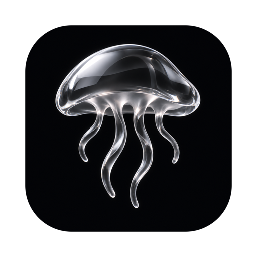
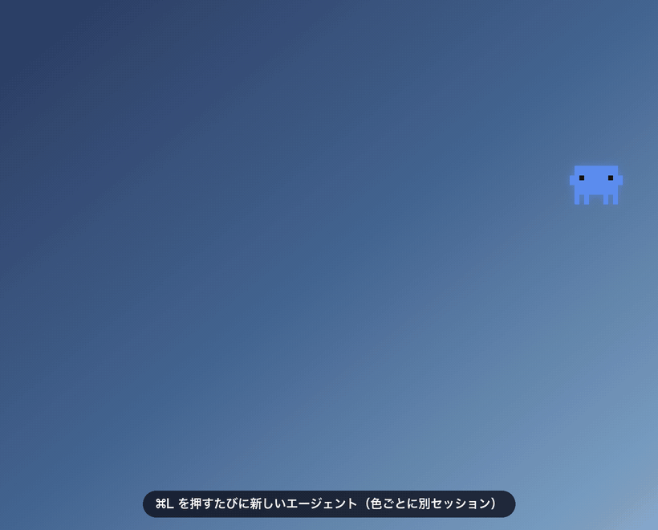
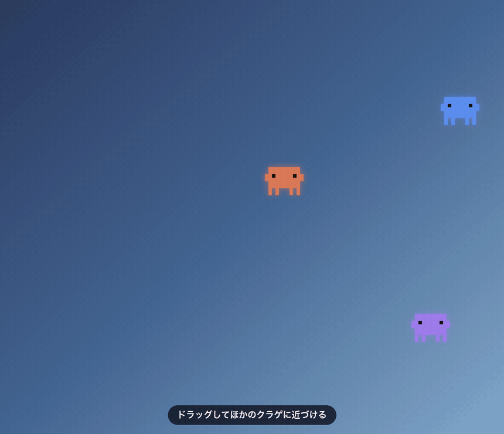
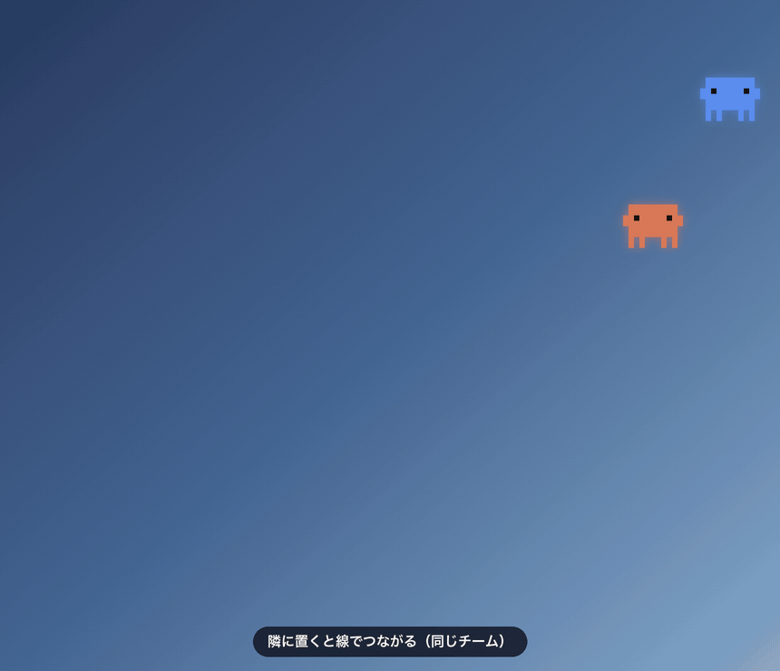
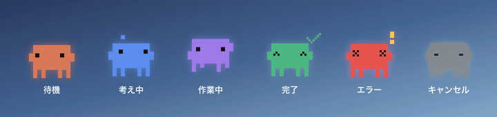
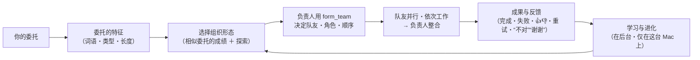

<p align="center">
  
</p>

<h1 align="center">Jellyfish AI</h1>

<p align="center">
  <a href="https://github.com/Rhizobium-gits/jellyfish-ai/actions/workflows/ci.yml"></a>
  <a href="https://github.com/Rhizobium-gits/jellyfish-ai/releases/latest"></a>
  <a href="https://github.com/Rhizobium-gits/jellyfish-ai/releases"></a>
  <a href="LICENSE"></a>
  
</p>

<p align="center">
  <a href="README.md">日本語</a> · <a href="README.en.md">English</a> · <b>简体中文</b>
</p>

<p align="center">
  这是一款 macOS 应用：AI 智能体常驻在桌面上，每一个都作为独立的 AI 智能体（Claude Code・Codex・Gemini）运行。<br>
  <i>macOS 桌面伙伴：屏幕边缘的每个小像素角色都是一个独立的 Claude Code 智能体。<br>按下 ⌘L，输入，然后看着它思考、工作、完成。</i>
</p>

<p align="center">
  <a href="https://github.com/Rhizobium-gits/jellyfish-ai/releases/latest/download/JellyfishAI.dmg"><b>⬇︎ 下载（.dmg）</b></a>
  &nbsp;·&nbsp; <a href="#下载与安装">安装</a>
  &nbsp;·&nbsp; <a href="#启动方法">启动方法</a>
  &nbsp;·&nbsp; <a href="#快速上手">快速上手</a>
  &nbsp;·&nbsp; <a href="#功能">功能</a>
  &nbsp;·&nbsp; <a href="#使用的-ai-与账户">使用的 AI</a>
  &nbsp;·&nbsp; <a href="#自主组织模式">自主组织模式</a>
  &nbsp;·&nbsp; <a href="#语言">语言</a>
</p>

<p align="center">
  
</p>

> [!NOTE]
> 这是个人开发的非官方应用，与 Anthropic、OpenAI、Google 无关。Claude、Claude Code 以及 Claude Code 的角色归 Anthropic 所有，ChatGPT 和 Codex 归 OpenAI 所有，Gemini 归 Google 所有。

## 下载与安装

**所需条件**

- macOS 14 或更高版本。这是 Apple 芯片 / Intel 均可运行的通用（universal）版本（已在 Apple 芯片的 macOS 26 上验证）。转写系统声音需要 macOS 26 或更高版本
- 以下 AI 的 CLI 中至少一个（[使用的 AI 与账户](#使用的-ai-与账户)）。Claude Code 可使用的功能最多
  - [Claude Code](https://code.claude.com/docs/en/setup)（Claude 账户）。会自动从 PATH、`~/.local/bin`、Homebrew 以及 VS Code / Cursor 扩展内置的 `claude` 中选出最新版本
  - [Codex CLI](https://github.com/openai/codex)（ChatGPT 账户）、[Gemini CLI](https://github.com/google-gemini/gemini-cli)（Google 账户）。ChatGPT 桌面应用内置的 Codex CLI 也会被自动找到，只要在应用中登录了 ChatGPT 就能直接使用

1. **安装要使用的 AI 的 CLI**
   按照各自的官方说明安装 Claude Code、Codex CLI 或 Gemini CLI。如果你在用 VS Code / Cursor 的 Claude Code 扩展，可以直接使用扩展内置的 `claude`。首次启动时出现的“账户与 AI”界面可以用来登录（之后安装的 AI 也可以在菜单栏的水母 › 🔑 账户与 AI 中登录）。尚未安装的 AI，也可以在该界面或菜单的“安装并登录…”中，经你允许后安装官方软件包并直接进入登录
2. **下载**
   **[下载 JellyfishAI.dmg](https://github.com/Rhizobium-gits/jellyfish-ai/releases/latest/download/JellyfishAI.dmg)**（始终是最新版本。也可以在 [Releases 的最新版本](https://github.com/Rhizobium-gits/jellyfish-ai/releases/latest) 页面获取同一文件，另有内容相同的 `.zip`）
3. **放进应用程序文件夹**
   打开 .dmg，把 **JellyfishAI** 拖到旁边的 **Applications**（应用程序）
4. **仅首次需要“仍要打开”**
   打开应用程序文件夹中的 JellyfishAI 时，macOS 仅在首次会拦下并提示“无法打开”（因为这是未经 Apple 公证的个人开发作品）。请关闭对话框，在 **系统设置 › 隐私与安全性** 靠下的位置点按“仍要打开”。从第二次起就可以正常打开

可以将同一发布中的 `SHA256SUMS.txt` 与 `shasum -a 256 JellyfishAI.dmg` 的结果对照，确认下载的文件是否完好。

> [!IMPORTANT]
> 智能体会 **不经确认** 地创建、编辑、删除文件和执行命令（Claude Code 的 Auto 模式等。危险的操作由各 AI 自身的安全机制拦下）。工作文件夹默认为主目录。详情请参阅 [权限与安全](#权限与安全) 和 [SECURITY.md](SECURITY.md)。
>
> 智能体使用你的 AI 账户（Claude 的 Pro / Max、ChatGPT、Google 账户）运行，并消耗其用量。**Jellyfish 不处理 API 密钥，也不会擅自收费**（以 API 密钥、按量计费登录的 AI，除非你允许，否则不会使用）。Claude Code 单次调用光是基础部分就要用掉数万 token，同时运行很多水母会很快达到用量上限。本周用了多少可以在菜单栏的水母中查看。

## 启动方法

不需要终端。和普通的 Mac 应用一样打开即可。

| 从哪里 | 方法 |
|---|---|
| **Spotlight** | 按 ⌘空格键，输入“Jellyfish”后按 Enter |
| **启动台 / 应用程序** | 点按 Jellyfish AI 的图标 |
| **访达** | 双击“应用程序”文件夹中的 JellyfishAI |
| **程序坞** | 把应用程序文件夹中的 JellyfishAI 拖到程序坞，以后只需点按 |
| **登录时自动启动** | 打开菜单栏的水母 › **登录时自动启动** |

- 启动后，菜单栏会出现像素风水母图标。Jellyfish AI 是常驻型应用，平时不会出现在程序坞中（只有打开聊天窗口期间才会出现在程序坞和 ⌘Tab 中）
- 运行中再次打开图标，会显示之前隐藏的水母。如果一只都没有，则会新建一只水母
- 退出请用菜单栏的水母 › **退出 Jellyfish AI**（⌘Q）。正在运行的智能体会被中断

## 快速上手

1. 无论正在使用哪个应用，按下 **⌘L** 就会出现一只新水母并打开输入框
2. 写下想让它做的事，按 **Enter**。输入框关闭，水母会一边用动作展示状态（思考中、工作中、完成、错误）一边工作
3. **轻点** 已完成的水母，就能在聊天窗口中查看结果，并可以直接继续下达指令
4. 不再需要的水母可以 **长按** 删除

首次启动时，会显示使用方法以及授予智能体的权限的说明。

## 菜单栏

点按菜单栏的水母，最上方会显示 **Claude Code 的账户和本周用量**（与 VS Code 的 Claude Code 扩展相同的信息）。

- 已登录账户的邮箱和套餐（例如：Claude Max 20x）
- 本周用量的进度条和百分比：**全部模型** 和 **Fable** 两个额度，以及各自的重置时间（75% 变为橙色，90% 变为红色）
- **📊 用量（按 AI，最近 7 天）**：Claude、ChatGPT（Codex）、Gemini 各自按模型、按账户的调用次数和 token（统计 Jellyfish 运行的部分，使用 CLI 报告的数字，仅在这台 Mac 上统计）。Claude 还会显示本周上限的百分比，ChatGPT 还会显示 5 小时和本周额度的百分比
- 打开菜单时，如果距离上次读取已超过 1 分钟，会重新从 Claude Code 读取（`claude auth status` 和 `claude -p /usage`。`/usage` 是 Claude Code 的内置命令，不会调用模型，也不消耗 token）。不会在后台定期获取

在下方可以新建水母、隐藏 / 显示全部水母、打开过去的会话和智能体列表，并设置外观、大小、屏幕识别、🔑 账户与 AI、🧠 模型（默认）、执行策略、电脑操控、团队、🧬 自主组织、外部工具（MCP）、聊天中的网页预览、登录时自动启动、🌐 语言。“关于 Jellyfish AI”“检查更新…”也在这里。

## 功能

- **⌘L 立即召唤智能体**：无论正在使用哪个应用，按 ⌘L 就会出现一只新水母，可以直接输入指令。按 Enter 发送后输入框关闭，水母开始工作
- **看动作就知道状态**：按照 Claude Code 的实际事件显示思考中、工作中（正在执行工具）、完成、错误、已取消。完成后动作停止，几乎不占用 CPU
- **并行且独立**：每只水母有各自的会话、工作文件夹、历史记录和进程。一只失败不会影响其他水母
- **轻点查看结果并继续**：在聊天窗口中查看结果，并在同一会话中继续下达指令。窗口是普通的 Mac 窗口（可以最小化、全屏、自由调整大小）
- **可以选择模型**：在聊天窗口顶部，为每只水母选择 **🤖 自动**（按任务选择：简短简单的用 Haiku，一般的用 Sonnet，繁重的用 Opus；最繁重的任务仅在本周 Fable 用量低于 75% 时使用 Fable），或自己指定 **Fable / Opus / Sonnet / Haiku**。自动时状态栏会显示所选模型及原因。思考强度（`--effort`）也在同一行。**ChatGPT（Codex）和 Gemini 的水母** 可以从该 CLI 提供的模型列表中选择（`codex debug models`、`gemini models`，不猜测名称），ChatGPT 还可以选择该模型支持的思考强度（low〜ultra 等）。未选择的水母遵循菜单栏的 **🧠 模型（默认）**（可为每个 AI 设定默认值）
- **用量一目了然**：菜单栏的水母中以进度条显示 Claude 账户和本周用量（全部模型、Fable）。如果登录了 ChatGPT（Codex），还会以进度条显示其方案（例如 ChatGPT Plus）和 **5 小时、本周额度的百分比**（只读取 Codex CLI 上次使用时写在自己记录中的值，不调用模型）。如果登录了 Gemini，会显示从 Jellyfish 运行的次数（今天、7 天）
- **看着屏幕工作**：当你像“这个屏幕”“显示的错误”“截图”这样明确指向屏幕时，会在发送时截取屏幕并交给智能体（不会拍到 Jellyfish 自己的窗口。像“列出一览”这样的普通指令不会截屏。也可以在聊天中切换为“每次附加 / 不附加”）。图片会缩小到长边不超过 1568px 再发送，每张约 1,800 token（约为 2560px 时的四成）
- **外部工具仅在提到时加载**：Claude Code 中配置的 MCP 服务器（Figma、Blender 等）和 claude.ai 的连接器，只在指令中出现其名称时才加载。平时不加载，因此每次约少用 4,800 token，启动也更快
- **智能体之间分工**：把一只水母靠近另一只，对方会发光并显示“松开即连接”，松开后就用线连起来，成为同一个团队。智能体可以委托队友做事，也可以创建新队友来分担，委托（委托方的颜色）和结果（受托方的颜色）会以光点在线上来回传递。⇧ 拖动可整队移动，按住 ⌥ 松开或点按线上的 ✂︎ 即可断开
- **自主组织模式**：每次委托时，智能体会自行决定适合该任务的团队形态（单人、分工、依次、多方案择优、分层 ＋ 审查员）并组建队友，再根据结果和 👍👎 等反馈学习如何选择组织，不断进化（[自主组织模式](#自主组织模式)）
- **日本語・English・简体中文**：用菜单栏的 🌐 切换显示语言。给智能体的说明也会用该语言传递（[语言](#语言)）
- **可以命名**：右键“重命名…”或聊天中的“名称”。智能体之间用这个名称互相称呼。没有名称的水母叫“Agent 编号”，编号会重复使用空出来的最小编号（不会一直增加。如果编号不连续，可以用菜单栏的“从 1 重新编号”）
- **打开文件或网页**：拜托它“打开桌面上的〇〇资料”，它会找到并用 Mac 的默认应用（预览、访达、浏览器等）打开。如果问“上面写了什么？”，则在聊天中回答
- **传递文件**：把文件拖放到水母或聊天窗口上即可作为附件（也可以用 📎 按钮）
- **在聊天中查看图片、PDF 和网页**：附加的图片和 PDF，以及对话中出现的图片、PDF 文件（路径），会以 Quick Look 缩略图显示在文字下方；网页 URL 会显示封面图片和标题（Mac 的 LinkPresentation，与“信息”等的链接预览相同）。点按即可在“预览”或浏览器中打开。智能体回复中出现的网页，只有在点按“显示封面”时才会读取（即使读取的网页等中暗藏的指令让智能体写出包含机密的 URL，也不会自动发送）。网页预览可以在菜单栏的“在聊天中显示网页预览”中关闭（图片和 PDF 只在这台 Mac 上显示）
- **说话输入（听写）**：点按聊天中的 **🎙** 或菜单的 编辑 › **开始听写**，即可在输入栏中开始 Mac 的听写，说的话会直接变成文字。这是 macOS 的功能，而不是 AI 识别（系统设置 › 键盘 › 听写；也可以用在那里设定的快捷键开始）
- **保留在 Claude Code 的记录中**：对话保存在 Claude Code 自己的会话（`~/.claude/projects`）中，因此也能从 VS Code 或终端接着打开。用菜单栏的“打开过去的会话”，可以把在 VS Code、终端中创建的会话也作为水母召唤出来。按住 ⌥ 选择即可归档（只是从列表中移除，不会删除记录。可以从“已归档”中恢复）

<p align="center">
  
</p>

<p align="center">
  
</p>

<p align="center">
  
</p>

<p align="center">
  
</p>

## 操作

| 操作 | 动作 |
|---|---|
| **⌘L**（在任何应用中） | 新建一只水母并立即打开输入框 |
| **轻点** | 打开聊天窗口（Enter 发送 / ⇧Enter 换行 / Esc 关闭） |
| **↑ / ↓**（输入框） | 调出在该会话中之前发送过的指令（在第 1 行按 ↑、在最后一行按 ↓。也包括在 VS Code、终端中输入的指令。最新一条之后会回到正在编辑的内容） |
| **长按** | 删除这只水母（如果正在工作，会确认“继续工作，只删除水母 / 取消工作并删除”） |
| **拖动** | 移动到任意位置（位置会保存）。靠近另一只水母后松开即可连接 |
| **⇧ 拖动** | 整个用线连接的团队一起移动 |
| **按住 ⌥ 松开** | 断开这只水母的所有连接 |
| **右键点按** | 聊天、名称、连接 / 断开连接、取消、隐藏、回到默认位置、删除 |
| **⌥⌘L** / 菜单栏 | 隐藏 / 显示全部水母（隐藏后工作仍会继续） |

在聊天窗口的下方，可以更改模型、强度、屏幕附加（自动判断 / 每次附加 / 不附加）、文件附件和工作文件夹。用“在 Claude Code 中打开”可以在终端中用 `claude --resume` 打开同一会话。

### 电脑操控

只有在聊天中打开了 **🖱 电脑操控** 的智能体，才能用 Jellyfish 的 MCP 工具操控这台 Mac（默认关闭）。

- `screen_capture`（按 1 像素 = 1 点截屏，因此图像上的坐标就是点击坐标）、`list_windows`、`ui_elements`（通过辅助功能读取按钮和输入框的位置）、`open_app`、`mouse_click`、`mouse_drag`、`scroll`、`type_text`、`press_keys`
- 同一时间只能有 1 个智能体操控。操控期间屏幕边缘会以该智能体的颜色发光，**按 Esc 停止**（也可以从菜单栏的“电脑操控”停止）
- 这些工具不预先授权，每次都要经过 Claude Code Auto 模式的安全判定。已指示智能体：除非用户明确要求，否则不输入密码、不付款、不发送、不公开发帖等
- 需要 **辅助功能** 和 **屏幕录制** 权限。可以用菜单栏的水母 › **🔐 权限（Full Access）** 中的“全部允许”一次设置（[一次性授予或撤销 macOS 权限](#一次性授予或撤销-macos-权限)）
- 使用只读取屏幕的工具（`screen_capture`、`list_windows`、`ui_elements`）期间，边缘也会发光，按 Esc 可停止。`open_app` 能打开的 URL 仅限 http / https
- macOS 的权限作用于整个应用，因此即使是开关关闭的智能体，Claude Code 执行的命令（如 `screencapture`）也能在权限范围内运行。不再使用时请撤销权限
- 如果在 Claude Code 中安装了 Blender 的 MCP，只要在指令中写上“Blender”，智能体就能使用它（[外部工具（MCP）仅在提到时加载](#外部工具mcp仅在提到时加载)）

### 一次性授予或撤销 macOS 权限

菜单栏的水母 › **🔐 权限（Full Access）** 中列出了 Jellyfish AI 拥有的 macOS 权限，以及授予后能做什么（Full Access 的范围）：辅助功能（电脑操控的点按和输入）、屏幕录制（屏幕附加、电脑操控、🎧）、完全磁盘访问权限（智能体无需每次询问即可读写桌面、文稿、下载等）、自动化（通过 AppleScript 等操控其他应用；macOS 会逐个应用确认）。

- **全部允许**：先用 `tccutil reset` 清除当前未生效的权限（仅限 Jellyfish AI），然后 Jellyfish AI 请求权限并打开系统设置。由你本人打开开关（macOS 不允许应用自行授予权限，Jellyfish 也不会这样做）
- **全部撤销**：关闭所有水母的电脑操控、停止 🎧 聆听，然后撤销 Jellyfish AI 的全部权限（`tccutil reset All ai.jellyfish.desktop`；不触及其他应用的权限）
- 两者都会在点按前的确认对话框中显示要执行的命令，并在终端中原样执行。也可以用命令完成同样的操作：

```bash
/Applications/JellyfishAI.app/Contents/Resources/permissions.sh grant    # 清除失效的旧权限并重新请求
/Applications/JellyfishAI.app/Contents/Resources/permissions.sh revoke   # 撤销 Jellyfish AI 的全部权限
/Applications/JellyfishAI.app/Contents/Resources/permissions.sh status   # 签名类型，以及应用的“🔐 权限”窗口
```

> [!NOTE]
> **系统设置中的开关明明打开却仍提示“请允许”、每次启动或更新都询问文件夹权限**，是因为替换了临时签名（ad-hoc）的版本。macOS 按签名内容（cdhash）识别应用，更新后授予旧版本的权限就不再生效（开关仍保持打开）。请用“全部允许”清除并重新授予。如果是从源代码安装的，用同一窗口中的 **“使用固定签名”**（`scripts/signing.sh create` → `scripts/install.sh`），之后的更新中权限也会保留。

### 收听（转写、翻译、会议纪要）

点按聊天中的 **🎧**，就会把 Mac 正在播放的声音（在线会议、视频等。不包括 Jellyfish 自己的声音）实时转成文字。转写由 macOS 26 的 SpeechAnalyzer 在本机处理（仅首次由系统下载语言模型），并带时间戳保存为文本文件。

- 停止后转写会附加到聊天中，因此可以接着拜托它“整理成会议纪要”“翻译成英文”“用 Word 写成报告”
- 智能体可以用 `read_transcript` 读取正在收听中的转写，因此也能实时翻译和总结（也能读取团队中队友的转写）
- 如果把写报告的角色和修改的角色组成团队，就能把“写 → 修改 → 改正”一直跑到最后（.docx 可以用 pandoc 或 python-docx 生成）
- 采集声音需要 **屏幕录制** 权限。需要 macOS 26 或更高版本

### 外部工具（MCP）仅在提到时加载

Claude Code 中配置的 MCP 服务器（位于 `~/.claude.json` 或项目的 `.mcp.json` 中的服务器，如 Figma、Blender 等）和 claude.ai 的连接器，如果每次都加载，光是这些就会增加基础 token。因此 Jellyfish 平时会加上官方选项 `--strict-mcp-config`，只用自己的 MCP（团队、电脑操控）运行。

- 指令中出现“Blender”“ブレンダー”“Figma”“フィグマ”这样的服务器名称时，从那一轮开始加载。同一对话的后续（如“再放大一点”）保持加载
- 仅仅是队友发来的委托内容中出现名称，不会加载。只有当委托方是因用户的指令而加载并运行时，队友一侧才会加载（防止被网页等诱导的队友让其他队友使用外部工具）
- 没有加载的那一轮，会告诉智能体一句：“没有加载外部工具。如有需要，请用户写上名称重新提出。”
- 可以在菜单栏的“外部工具（MCP）”中切换“仅在提到时 / 始终加载 / 不使用”。加载时，聊天的状态栏会显示 🧩 和名称

实测（Haiku 5.5，“只回复 OK”1 次）：加载 39,945 token、3.8 秒 → 不加载 35,139 token、2.9 秒。

### 团队（分工）

1. 拖动水母使其**靠近**另一只水母时，对方会被虚线圆圈点亮，并显示“松开即与 〇〇 连接”。松开后它会顺势移到能看见连线的距离并连接起来。连在一起的一组就是一个团队
   - 与离得远的水母也可以通过 右键 › 连接 来连接
   - 按住 ⇧ 拖动可整队移动（如果在松开鼠标前先松开 ⇧，队友会回到原来的位置）
   - 聊天窗口上方会显示“👥 与 〇〇 组队”，可以看出能分配给谁
2. 对其中任意一只说“创建队友来分工”“请审查员帮忙修改”之类的话。智能体会使用 Jellyfish 的 MCP 工具
   - `create_teammate`：在自己旁边创建新队友并把工作交给它（继承工作文件夹和模型）
   - `assign_task`：委托团队中的队友工作（如果对方正在工作则排队等待）
   - `wait_for_tasks`：接收所委托工作的结果
   - `list_team`：查看队友及其状态
3. 受托方的聊天中会留下“📨 来自 〇〇 的委托”。结果会返回委托方，由委托方整合
4. 连接可以通过以下方式断开：把指针放在线上时出现的 ✂︎；按住 ⌥ 拖动后松开（线会变红并显示“松开即断开连接”）；或 右键 › 连接关系

每个团队最多 8 只。智能体创建的队友只能再往下创建 1 层（从用户的水母算起共 2 层）。可以在菜单栏的“团队（分工）”中关闭整个功能。

## 自主组织模式

打开菜单栏的水母 › **🧬 自主组织 › 自主组织模式** 后，每次委托时智能体都会 **自行组建适合该任务的组织** 来推进（默认关闭。团队（分工）也会一起打开）。



**组织形态**（`form_team` 的 `formation`）

| 形态 | 示例 | 适合的委托 |
|---|---|---|
| 独自完成 `solo` | | 小型、难以拆分的委托 |
| 独自完成 ＋ 审查员 `solo+r` | 写 → 修改 | 文章、代码、翻译 |
| 分工并行 `parallel2〜5` | 分别调查 5 家公司 | 能拆成独立部分的委托 |
| 按顺序 `pipeline2〜4` | 调查 → 撰写 → 核实 | 后一步要用到前一步结果的委托 |
| 分别尝试再择优 `ensemble2〜3` | 提出 3 个方案并择优 | 创意、设计 |
| 分层 `hierarchy2〜3` | 子负责人进一步分工 | 规模大、范围广的委托 |

形态后面的 `+r` 表示在最后安排一名查看所有人结果的审查员。

**工作方式**

1. 收到委托后，Jellyfish 会根据委托的特征（词语、委托的类型、长度。支持日语、英语、中文），参考以往的成绩选出推荐的形态，并告诉负责人（你委托的那只水母）
2. 负责人用 `form_team` 决定队友的名称、角色和工作来组建团队。用 `after` 指定顺序后，前一位的结果会自动附在下一位的委托中。如果有比推荐更合适的形态，负责人可以更改
3. 队友出现在旁边并用线连接，并行或依次工作。聊天的状态栏会显示 🧬 和当前组建的形态
4. 在下一次委托中没有用到的队友会被清理（同名的队友会继续使用）。也可以用菜单中的“解散当前组织”来清理

**学习与进化**（后台・本机内）

- 每次委托后，会根据成果（完成、失败、耗时、队友的成败）和你的反馈（聊天中的 👍 / 👎，重新运行、取消，以及接着发送的“不对”“重做”“谢谢”“完美”等）打出 0〜1 的分数
- 用 Beta 分布保存每种形态的预期，**越相似的委托影响越大**，据此进行选择（Thompson 采样）。在使用效果好的形态的同时，偶尔也尝试其他形态来学习
- **未知的委托**（还没有相似的委托）会根据委托类型的预估和整体趋势来选择，并从其结果中学习
- 会从成绩好的形态中产生略作变化的形态（人数、有无审查员、结构），明显差的形态会被淘汰（“独自完成”会保留）。代数、形态数量以及每种委托类型的最佳形态显示在菜单中，详情见“打开学习报告”
- 记录只保存在 `~/Library/Application Support/JellyfishAI/org/`，不会发送到任何地方。可以用“重置学习…”清除。关闭“从成果和反馈中学习”后不再记录（选择时仍会使用已有的学习结果）

> [!NOTE]
> 每多一个队友，Claude Code 的用量就会相应增加。对于小的委托会引导独自完成，人数越多的形态在选择时会被略微打折扣。电脑操控工具不会交给队友（只给用户直接委托的智能体）。

## 语言

在菜单栏的水母 › **🌐 言語 · Language · 语言** 中，可以选择 **日本語 / English / 简体中文 / 自动（跟随系统）**。

- 菜单、聊天、说明等的显示会立即切换（已打开的聊天会重新创建）
- 交给智能体的说明（团队、电脑操控、自主组织等）也会用该语言传递，因此回复也更容易使用该语言
- “自动”会跟随 macOS 的“首选语言”（如果不是日语、英语、中文中的任何一种，则使用英语）
- 指向屏幕的词语判定（“この画面”“this screen”“这个屏幕”等），以及自主组织中对委托类型和反馈的识别，都支持这 3 种语言

## 使用的 AI 与账户

运行智能体的 AI 可以从 **Claude（Claude Code）、ChatGPT（Codex CLI）、Gemini（Gemini CLI）** 中选择。每一个都以 **你自己账户的登录状态**，运行这台 Mac 上安装的官方 CLI。

| AI | CLI | 登录所用的账户 | 不经确认运行时的规则 | 可用功能 |
|---|---|---|---|---|
| Claude | Claude Code | Claude（Pro、Max 等） | Auto 模式（危险操作由 Claude Code 的安全判断阻止） | 全部 |
| ChatGPT | Codex CLI | ChatGPT（Plus、Pro 等） | 沙盒（只能写入工作文件夹内、无网络） | 对话、工作、继续、团队（创建和委托队友） |
| Gemini | Gemini CLI | Google 账户 | auto_edit（只自动批准工作文件夹内的编辑、不执行命令） | 对话、工作、继续、团队（创建和委托队友） |

- **首次启动时** 会出现“账户与 AI”界面，可以分别登录各个 AI
- **未安装的 AI**，在该界面的“安装并登录…”或菜单的“安装 〇〇 并登录…”中，会显示要执行的命令并请求许可。允许后，会在终端中执行该命令安装官方软件包，接着开始该 CLI 的登录，之后只需在浏览器中登录即可
  - Claude：Anthropic 的官方安装程序（`curl -fsSL https://claude.ai/install.sh | bash`，安装到 `~/.local/bin`）
  - ChatGPT（Codex）：`npm install -g @openai/codex`。没有 npm 或无法写入 npm 的全局目录时，使用 `brew install --cask codex`
  - Gemini：`npm install -g @google/gemini-cli`。同样，不行时使用 `brew install gemini-cli`
  - 不使用管理员密码（sudo）。npm 和 Homebrew 都没有时，会打开官方指南（安装 ChatGPT 桌面应用也可以使用其中的 Codex CLI）
- **之后** 要添加账户、用其他账户重新登录或更改使用的 AI，请在菜单栏的水母 › **🔑 账户与 AI** 中操作。登录状态（✓・⚠️）也显示在这里
- **也可以为每只水母选择 AI**：聊天窗口顶部的“AI”。更改后会开始新的对话。未单独选择的水母遵循菜单中的“要使用的 AI”。队友使用与创建者相同的 AI
- 登录时会在终端中打开各 CLI 的官方登录（`claude auth login --claudeai`、`codex login`、Gemini CLI 的“Sign in with Google”），由你本人在浏览器中完成。**Jellyfish 不会接收或保存密码、令牌或 API 密钥**
- **团队（创建和委托队友）与自主组织适用于所有 AI 的水母**。ChatGPT 和 Gemini 的水母也能用 Jellyfish 的团队工具增加队友：新的水母出现在旁边并连上线，委托和结果以光的形式在线上往返（[按各 AI 的擅长之处分工](#按各-ai-的擅长之处分工)）。电脑操控、外部工具（MCP）和模型的“自动”仅限 Claude。Codex 和 Gemini 也可以选择模型（见下方的模型选择）
- **屏幕附加、文件附加、🎧 系统声音转写和 🎙 听写适用于所有 AI 的水母**。对 ChatGPT（Codex）用 `--image` 附加图片（Codex 能读取文件但看不到图片），对 Gemini 则把水母数据文件夹中存放附件（屏幕截图、转写）的位置加入其工作区（Gemini 无法读取工作文件夹之外的文件；自己拖入的文件放在工作文件夹中最可靠）
- Gemini 会确认是否信任文件夹，在不信任的文件夹中不会运行。请在聊天中用“在此文件夹打开 Gemini”打开，仅在这是你信任的文件夹时才选择信任（Jellyfish 不会跳过这项确认）

### 按各 AI 的擅长之处分工

团队的带队者（任何 AI 都可以）可以为每个队友选择所用的 AI，按各自擅长之处分工。给带队者的说明中会写明当前已登录、可以使用的 AI，以及由 Jellyfish 的运行方式决定的擅长与不能做的事。

| AI | 适合的角色 | 不能做的事 |
|---|---|---|
| Claude | 带队、整合、审查，长时间的多步骤工作，执行命令，Web 搜索，电脑操控（允许时），外部工具 | — |
| ChatGPT（Codex） | 实现和修改代码，运行测试和构建 | 网络（Web 搜索、下载软件包），写入工作文件夹以外的位置 |
| Gemini | 用 Google 搜索和网页调研，总结和比较大量资料或代码，写作 | 执行 shell 命令 |

- 像“调研交给 Gemini，实现交给 Codex，总结和审查交给 Claude”这样委托后，带队者会用 `create_teammate` / `form_team` 的 `engine`（和 `model`、`effort`）为每个队友选择 AI、模型和思考强度并创建（自主组织模式也一样）。**任何 AI 的水母都可以带队**：Claude 的水母可以叫出 ChatGPT 的队友，ChatGPT 的水母也可以叫出 Claude 的队友，一起分工或开发。在聊天顶部“AI”中自己选好 AI 的水母（例如 Claude 和 ChatGPT）靠近连接后，就能互相委托、互相返回结果
- 回复的标题是写出该回复的 AI 的名称（Claude、ChatGPT（Codex）、Gemini）。思考强度可以为 Claude（low〜max）和 ChatGPT（该模型支持的强度）选择。Gemini CLI 没有指定思考强度的选项，因此交由 Gemini CLI 的设置决定
- 如果指定了无法使用的 AI（未安装、未登录或仍是 API 密钥按量计费），带队者会收到原因和可用 AI 的列表，并改用其他 AI 重新委托
- **数据交接**：每次给带队者的委托都会创建团队共享的 **交接文件夹**（数据文件夹的 `handoff/` 下，只有你本人可以打开），并允许任何 AI 的队友读写（Claude 用 `--add-dir`，Codex 作为沙盒的可写文件夹，Gemini 用 `--include-directories`）。大量数据和中间成果以文件形式放在这里，委托和结果中写明路径。用 `after` 排好顺序的队友，委托中也会附上前一位的结果
- 最终成果会保存到你要求的位置（如工作文件夹）。交接文件夹如果为空会在该轮结束时清理，用过的会在 7 天后清理
- 正在处理队友委托的智能体，不会创建或委托与自己不同 AI 的队友（各 AI 的安全机制不同，避免借助别的 AI 去做自己不被允许的事）。跨 AI 分工从你直接委托的水母（带队者）开始
- 队友的状态栏和标题会显示它的 AI 和模型。可以在菜单栏的 **📊 用量** 中按 AI 查看用量

### 不会擅自收费

- Jellyfish **不使用 API 密钥（按量计费）**。Claude 也一样
  - 即使 shell 设置中有 `ANTHROPIC_API_KEY`、`OPENAI_API_KEY`、`CODEX_API_KEY`、`GEMINI_API_KEY`、`GOOGLE_API_KEY` 等，也不会传给智能体的 CLI
  - 如果 CLI 以 API 密钥或云服务（Anthropic Console、Bedrock、Vertex AI 等）登录，就不运行该水母，并提示你用订阅账户重新登录
- 只有在确实想用 API 密钥时，才在菜单栏的水母 › 🔑 账户与 AI 中打开“允许使用 API 密钥（按量计费）”（会请求确认。各 API 会按使用量收费）
- 超出订阅用量上限时是否购买额外用量，保持各账户自己的设置（Jellyfish 不会更改）

## 更新

- 在菜单栏的水母 › **检查更新…** 中，向 GitHub 确认是否有新版本（仅在选择时。不会自动联网）
- 如果有新版本，点按 **“更新”** 后，会从 GitHub 的发布下载新版本（.zip），确认 `SHA256SUMS.txt` 的校验和、内容（是否为该版本的 Jellyfish AI）和代码签名后替换应用并重新打开（设置、水母和对话都会保留）。不点按就什么都不做
  - 有水母正在工作时不会替换。如果应用是从无法修改的位置（如 .dmg 内）打开的，或者 macOS 阻止了替换（系统设置 › 隐私与安全性 › App 管理），会引导你前往下载页面
- 在同一对话框中点按 **“在终端中更新”**，会在终端中运行对话框里显示的命令进行更新。如果你是从源代码用 `scripts/install.sh` 安装的，则会拉取、重新构建并替换（保持你自己的签名）
- 如果要手动替换，下载 .dmg，按照与 [安装](#下载与安装) 相同的方式拖到应用程序文件夹中

### 一条命令更新

可以在终端中确认是否有新版本并直接更新。脚本内置在应用中，没有源代码也能使用。

```bash
# 只确认是否有新版本（退出码 0 = 已是最新，10 = 有新版本）
/Applications/JellyfishAI.app/Contents/Resources/update.sh --check

# 如果有新版本，下载并确认后替换应用并重新打开（替换前会询问；加 --yes 不询问）
/Applications/JellyfishAI.app/Contents/Resources/update.sh
```

- 确认的内容与应用中的“更新”相同：只获取本仓库该发布中的 `JellyfishAI-<版本>.zip` 和 `SHA256SUMS.txt`，确认校验和、内容（是否为该版本的 Jellyfish AI）和代码签名（如果当前版本使用证书签名，则需为同一证书）。有水母正在工作时不会替换，不使用 sudo
- 在源代码文件夹中使用 `scripts/update.sh`。**如果是从源代码安装的，请使用 `scripts/update.sh --source`**（确认没有未提交的更改后，执行 `git pull --ff-only` → `scripts/install.sh`；如果有签名证书会用它签名，权限得以保留）
- `--app <路径>` 指定要替换的 .app，`--no-open` 表示替换后不打开
- 替换后如果要使用电脑操控或屏幕附加，请重新授予屏幕录制和辅助功能权限（[注意事项](#注意事项)）

### 让每次更新后不再请求权限

如果不想每次更新后都被请求权限，请在终端中运行一次下面的命令（在存放源码的文件夹中。如果还没有，请先按照 [从源码构建](#从源码构建) 执行 `git clone`）。

```bash
cd ~/jellyfish-ai
scripts/signing.sh create
scripts/install.sh
```

> [!IMPORTANT]
> 在签名确认对话框中，请选择 **“允许（Allow）”**。如果选择 **“始终允许（Always Allow）”**，其他程序也能在不经确认的情况下使用这个证书。

- `scripts/signing.sh create` 会在登录钥匙串中创建 Jellyfish 专用的签名证书（自签名），`scripts/install.sh` 会用它签名并安装。macOS 会把“用同一个证书签名的 Jellyfish AI”视为同一个应用，因此文件夹（桌面、文稿等）、屏幕录制和辅助功能的权限在之后的更新中也会保留
- 只有在第一次切换到证书时，才会再请求一次权限
- 之后的更新请用 `scripts/update.sh --source`（`git pull` → `scripts/install.sh`）安装（.dmg 和 .zip 版本是 ad-hoc 签名，替换后会再次请求权限）
- 用 `scripts/signing.sh status` 查看，用 `scripts/signing.sh delete` 停止使用

## 从源码构建

不需要 Xcode，只用 Command Line Tools 中的 Swift（5.10 或更高版本，已在 6.3 上验证）即可构建。

```bash
git clone https://github.com/Rhizobium-gits/jellyfish-ai.git
cd jellyfish-ai
scripts/install.sh          # 构建后放入应用程序文件夹并启动
```

- 先用 `scripts/signing.sh create` 创建签名证书，重新安装后 macOS 的权限（文件夹、屏幕录制、辅助功能）也会保留（[注意事项](#注意事项)）
- 用 `scripts/install.sh` 安装后，之后就能像普通应用一样不经终端打开。会先退出正在运行的 Jellyfish AI 再替换（有正在工作的智能体时不做任何操作）
- 只构建用 `scripts/build.sh`（→ `dist/JellyfishAI.app`，适用于这台 Mac 的 CPU），测试用 `scripts/test.sh`（swift test）
- 应用图标由 `Resources/AppIcon.png`（1024px 的正方形）放入 macOS 图标的圆角框中生成。替换后重新构建即可更改
- 分发包用 `scripts/release.sh` 生成到 `dist/release/`（universal 的 .dmg、.zip、SHA256SUMS.txt）。更新 `VERSION` 和 `CHANGELOG.md` 并提交、push 后，用 `scripts/release.sh --publish` 发布到 GitHub Releases
- **下载次数**：`scripts/downloads.sh` 从 GitHub 读取每个发布的下载次数（`.dmg` = 从 README 或发布页面下载安装的次数，`.zip` = 应用内“更新”和手动下载 .zip；`--traffic` 还会显示最近 14 天的页面浏览量和 clone 次数，`--json` 输出 JSON）。README 顶部的徽章是 `JellyfishAI.dmg` 的下载总数。每个版本的 .dmg 都使用同一个名称 `JellyfishAI.dmg`，因此 `releases/latest/download/JellyfishAI.dmg` 始终指向最新版本，次数也集中在一处（1.0.5 之前的文件名带版本号，这部分包含在 `scripts/downloads.sh` 中）。GitHub 会重复计算同一个人的多次下载，不计算 clone 和源代码 zip

## 权限与安全

- Jellyfish 不处理 API 密钥，也不会擅自收费。不使用以 API 密钥（按量计费）登录的 AI，也不传递 API 密钥环境变量（[不会擅自收费](#不会擅自收费)）
- 智能体以 Claude Code 官方的 **Auto 模式**（`--permission-mode auto`）运行。无需确认即可进行文件操作和命令执行，带出认证信息、意外的对外发送、无法挽回的操作等会被 Claude Code 一侧的安全判定拦下。所加的选项会在启动时先用 `claude --help` 确认存在后再使用
- 当前的权限范围以及正在使用的 `claude` 的位置和版本，可以在菜单栏的“执行策略”中查看
- 不会更改 macOS 的权限设置。只有在使用屏幕识别时，才需要在“系统设置 › 隐私与安全性 › 屏幕录制”中允许 Jellyfish AI
- Jellyfish AI 自身的网络通信，只有选择“检查更新…”时读取一次 GitHub 的公开 API、点按“更新”时从 GitHub 获取该发布的文件，以及聊天中的网页预览（读取对话中出现的网页，可在菜单中关闭）（不会自动检查，也不发送使用情况）。安装未安装的 AI 时，会在终端中执行你允许的命令。指令和附件通过 Claude Code 发送给 Anthropic。菜单中的用量是在打开菜单时由 Claude Code 从 Anthropic 读取的
- `bypassPermissions` 等会绕过安全判定的模式，即使写在 `settings.json` 中也不会使用
- 电脑操控只在你在该智能体的聊天中直接要求时使用（队友的委托中不使用）
- 通过 `jellyfish://` URL 从外部进行的操作，只接受切换显示等无害的操作（不接受发送指令、允许电脑操控等。连续的调用会被节流，也不会抢走键盘输入焦点）
- .app 启用了 Hardened Runtime 并已签名（防止其他程序注入应用并利用屏幕录制等权限）
- 自主组织的学习只在本机计算，记录（`org/`）以仅本人可读的权限保存
- 详情请参阅 [SECURITY.md](SECURITY.md)。漏洞请通过 Security 标签页私下报告

## 注意事项

- ⌘L 是全局使用的，因此会与浏览器跳转到地址栏的快捷键冲突。当 `settings.json` 的 `hotKeyPassthroughApps` 中写入了 bundle ID 的应用位于前台时，⌘L 会交还给该应用。如果其他应用已先占用 ⌘L，则改用 ⌃⌥L
- 退出应用后，正在运行的智能体会被中断（下次启动时会以“中断”保留下来）
- 发布的 .app 是 ad-hoc 签名，换成新版本后 macOS 会把它视为另一个应用，并再次请求文件夹（桌面、文稿等）、屏幕录制和辅助功能的权限。请用菜单栏的水母 › **🔐 权限（Full Access）** 中的“全部允许”清除旧权限并重新授予
- 如果从源码安装，先用 `scripts/signing.sh create` 创建 Jellyfish 专用的签名证书（自签名），`scripts/install.sh` 就会用它签名，即使重新构建，**允许过一次的权限也会一直有效**（添加水母时也不会每次都询问）。私钥以不可导出的方式导入，每次用它签名时 macOS 都会请求确认。用 `scripts/signing.sh status` 查看，用 `delete` 删除

## 数据存储位置

`~/Library/Application Support/JellyfishAI/`（设置、水母、每个智能体的历史和原始事件、转写、自主组织的学习、日志。文件夹设为仅本人可打开的权限）。可以用菜单栏的“打开设置文件夹”打开。交给智能体的屏幕图像会在 7 天后删除，删除水母时该水母的原始事件和图像也会一并删除。对话本身作为 Claude Code 的会话保留在 `~/.claude/projects/` 中。启动时加上环境变量 `JELLYFISH_DATA_DIR`，则会使用其他位置（用于演示录制和测试）。

### 卸载

1. 在菜单栏的水母中关闭“登录时自动启动”，然后选择“退出 Jellyfish AI”
2. 把应用程序文件夹中的 JellyfishAI 移到废纸篓
3. 如果还要删除数据，删除 `~/Library/Application Support/JellyfishAI/`（窗口位置等用 `defaults delete ai.jellyfish.desktop`）
4. 已授予的权限可以在“系统设置 › 隐私与安全性”的各项（屏幕录制、辅助功能）中撤销

Claude Code 的会话（`~/.claude/projects/`）属于 Claude Code，因此即使删除 Jellyfish 也会保留。

## 开发

- 设计说明：[docs/ARCHITECTURE.md](docs/ARCHITECTURE.md)
- 可以通过 `jellyfish://` URL scheme 从外部操作
  - 随时可用（快捷指令.app、Raycast 等）：`new`, `open?agent=2`, `toggle`, `show`, `hide`, `arrange`, `style?v=pixel|realistic`, `scale?v=1.25`
  - 仅在启动时加上环境变量 `JELLYFISH_AUTOMATION=1`，并用 `token=…` 附上数据文件夹中 `automation.token` 的口令时可用（用于自动测试和演示录制。`scripts/demo/recorder.swift` 会自动附上）：`renumber`, `prompt?agent=2&text=…`, `type?agent=2&text=…`, `new?cwd=…`, `folder?agent=2&path=…`, `pc?agent=2&on=1`, `rename?agent=2&name=…`, `link?a=2&b=3`, `unlink?a=2&b=3`, `move?agent=2&dx=…`, `press?agent=2`, `accounts`, `state?agent=2&s=working`, `remove?agent=2`, `login?on=1`, `debug`
- 用 `.build/debug/JellyfishAI --pixel-sheet out.png` 输出像素画的帧一览，用 `--settle-test` 验证完成时的静止，用 `--account-menu out.png` 绘制菜单中的账户和用量栏（实际从 claude 读取）
- 显示的文字在源码中用日语书写并用 `L("…")` 包裹，译文放在 `l10n/en.json`、`l10n/zh.json` 中。用 `scripts/l10n.py missing en` 查看缺失的译文，用 `scripts/l10n.py gen` 生成 Swift 的表，用 `scripts/l10n.py check` 检查缺失和 `%@` 的数量（CI 中也会检查）。用环境变量 `JELLYFISH_LANGUAGE=en` 可以固定语言启动
- README 的 GIF 可以用 `scripts/demo/record.sh` 重新录制（不会触碰日常数据，而是用空的演示数据实际运行 Claude Code 来录制。需要 Pillow 和 ffmpeg）

## 许可证

[MIT](LICENSE)。变更记录见 [CHANGELOG.md](CHANGELOG.md)。
